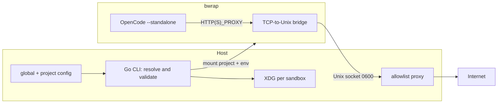

# RFC-0001: Go agent sandbox with network policy and routing (v1)

- **Status:** In review
- **Author(s):** Gustavo
- **Reviewers:** Gustavo (self-review)
- **Date:** 2026-10-29 (creation); 2026-11-01 (grill revision); 2026-11-03 (deadline extension); 2026-11-05 (plugin spike)
- **Feedback deadline:** 2026-11-15 (extended from 2026-11-08 to close together with RFC-0002; the ADR-0004 open question 1 spike that caused the earlier extension was resolved on 2026-11-05)
- **Decision review:** 2 weeks after dogfood starts, which begins after the `allowlist` gate
- **Related ADR:** [ADR-0001](../adr/0001-sandbox-opencode-com-bwrap.md)
- **Supersedes / Related:** [ADR-0002](../adr/0002-per-sandbox-state-and-credentials.md), [ADR-0003](../adr/0003-pinned-skills-and-snapshot.md), [ADR-0004](../adr/0004-quality-gate-hooks.md); supersession: N/A
- **Origin:** ADR-0001 after the 2026-10-29 grill and the 2026-11-01 revision (verdict: solid with caveats; `allowlist` conditioned on the full matrix)

## 1. Summary

The starting point was the `opencode-sandbox` script: it isolates the filesystem and processes with `bwrap`, but shares the host network, inherits the environment, and mounts OpenCode config/data read/write. We propose a Go CLI that resolves a declarative per-project policy (`host`/`none`/`allowlist`), applies per-sandbox XDG, `--clearenv`, and `--standalone`, and prints the resolved configuration.

v1 covers **network/routing + minimum state isolation**. The wrapper and legacy behavior are removed: the user calls `asb run` directly. Environment values do not go in the `bwrap` argv; the host `~/.gitconfig` is not mounted; and `allowlist` is released only with the full matrix. Skills, hooks, and credential import belong to dedicated ADRs. The expected impact is to reduce accidental damage and prompt injection without a container, while keeping startup cost low.

## 2. Context and problem

The legacy script (`opencode-sandbox`, removed in v1) solves filesystem and process isolation, but not access control:

- `opencode-sandbox:22-68` builds the `bwrap` arguments.
- `opencode-sandbox:38-45` keeps the project read/write, uses `tmpfs` as `$HOME`, and makes a **writable** bind of `~/.config/opencode`, `~/.local/share/opencode`, `~/.local/state/opencode`, and `~/.cache/opencode`.
- `opencode-sandbox:57-63` isolates PID, IPC, UTS, and cgroup, with `--die-with-parent` and `--new-session`.
- `opencode-sandbox:6-20,53-55` generates a `resolv.conf` and mounts it over the real symlink target; it does **not** use `--unshare-net`, so it shares the host network namespace.
- `opencode-sandbox:70-75` uses `--standalone` so the OpenCode server starts inside the sandbox instead of using the shared host service.
- The global database lives at `~/.local/share/opencode/opencode.db` (`opencode debug paths`), exposed by the binds.
- There is no tool code, configuration schema, or tests.

**Who feels it:** developers who run coding agents in local repositories and want to limit network, secrets, and files without setting up a container.

**If nothing changes:** the choice is between accepting host networking, the inherited environment, and writable global state, or not using a sandbox. The script gives a sense of isolation that does not cover what the agent accesses on the network and in the environment.

**Threat model:** chosen by the user. The strong recommendation is to cover **accidental damage and prompt injection from LLM agents** in your own repositories; it is not containment of a sophisticated attacker exploiting the kernel or the host. The tool provides control mechanisms and a startup path without an insecure default.

> **Unvalidated premises:** the default motivation is a product choice, not a metric; WSL has no automated runner; project `.opencode` discovery in OpenCode V2 was not confirmed (out of v1); the comparison with container/Podman is analysis, not a benchmark. npm/pip passed manually on 2026-10-29; user-mode NAT was partially tested and must enter the matrix.

## 3. Goals and non-goals

**Goals:**

- **O1.** Declarative per-project config, with named profiles, CLI override, and printing of the resolved config before execution.
- **O2.** Three network profiles in v1: `host`, `none`, and `allowlist`; in `allowlist`, block direct egress, deny private/link-local/metadata IPs, resolve DNS in the proxy, and prevent QUIC/IPv6 as escape paths.
- **O3.** Per-sandbox XDG, `--clearenv` + env allowlist, and `--standalone`; no writable bind of OpenCode global state.
- **O4.** Single `bwrap` backend; Linux and WSL; Go CLI, single binary, no daemon.
- **O5.** Fail with a clear message when `bwrap` or user namespaces are unavailable.
- **O6.** Dogfood in the repository, starting after the `allowlist` gate, with a decision review 2 weeks later.
- **O7.** `allowlist` is released only when the full escape matrix passes: curl, git, Node, OpenCode, npm, pip, IPv6, QUIC, DNS rebinding, user-mode NAT, `--clearenv`, `--standalone`, and writes to the host.
- **O8.** Secrets from `env.allow`/`from_file` do not appear in the `bwrap` argv; they are delivered through an fd/ephemeral file read by `asb exec`.
- **O9.** The host `~/.gitconfig` is not mounted; `[git] mode = minimal`/`manual`/`off` controls what enters.
- **O10.** The `opencode-sandbox` wrapper and the legacy fallback are removed; there is no implicit `--profile host`.

**Non-goals:**

- Container/Podman and a shared image in v1 (discarded alternative; see §6).
- Skills, hooks, and credential import (`auth export/import`): ADR-0003, ADR-0004, and ADR-0002.
- macOS; configurable mount policy; CPU/memory limits; specific seccomp/AppArmor.
- L2 bridge, removal of the local network, and transparent proxy as default.
- Containing a compromised agent beyond what the chosen policy allows.
- GUI, skills marketplace, or multi-tenancy.

## 4. Requirements and constraints

| Requirement | Type | Origin |
|---|---|---|
| No implicit network default; init requires a choice | Non-negotiable | ADR-0001 |
| Wrapper/legacy removed; no implicit `--profile host` | Non-negotiable | 2026-11-01 revision |
| In the `allowlist` profile, direct egress is blocked | Non-negotiable | Product promise |
| Host secrets and global state are not mounted | Non-negotiable | ADR-0001 (v1) |
| Secrets from `env.allow`/`from_file` do not go in the `bwrap` argv | Non-negotiable | 2026-11-01 revision |
| Host `~/.gitconfig` is not mounted; `[git]` controls what enters | Non-negotiable | 2026-11-01 revision |
| `--standalone` so the server runs inside the sandbox | Non-negotiable | 2026-10-27 spike |
| The proxy is the only network channel in `allowlist` | Non-negotiable | 2026-10-27 spike |
| Proxy socket `0600` in a private/read-only directory; bridge read-only | Non-negotiable | Channel attack surface |
| Socket in `XDG_RUNTIME_DIR` or `/tmp/asb-<uid>/<hash>`; never `/tmp/asb` | Non-negotiable | 2026-11-01 revision |
| No `/dev/net/tun`/user-mode NAT and no host sockets besides the proxy | Non-negotiable | Allowlist bypass |
| Single `bwrap` backend; no container in v1 | Non-negotiable | Grill decision (2026-10-29) |
| Linux + WSL | Non-negotiable | v1 scope |
| Auditable resolved config | Non-negotiable | Control/audit |
| Single Go binary | Desirable | Chosen stack |
| Versionable config: `asb.toml` in the project + `$XDG_CONFIG_HOME/asb/config.toml` | Non-negotiable | 2026-10-29 decision |
| Startup measured in two parts (setup and until the command); no numeric target in v1 | Desirable | Interactive use |
| Full matrix: git, Node, OpenCode, rebinding, NAT, `--clearenv`, `--standalone`, host writes, and secrets in argv | Gate | `allowlist` release |
| Base env allowlist closed (§5.4) | Non-negotiable | 2026-10-29 decision |
| Runs without root/daemon | Desirable | Friction driver |

## 5. Proposal

### 5.1 Overview



The host is the source of truth (config and proxy). The sandbox receives the project read/write, a `$HOME` on `tmpfs`, and its own XDG. In `allowlist`, the proxy's Unix socket is the only egress channel; `bwrap` neither filters domains nor creates a bridge, so the proxy and bridge are provided by the tool.

### 5.2 Interface and configuration

- Binary: **`asb`**. Global config at `$XDG_CONFIG_HOME/asb/config.toml` (default `~/.config/asb/config.toml`).
- Project config in **`asb.toml`** at the repository root, versionable. TOML; `version = 1` required.
- **Precedence:** CLI flag > project `asb.toml` > global config > **no default**. First use without a profile fails and asks for `host`, `none`, or `allowlist`. Without `asb.toml` and without `--profile`, `asb run` fails; there is no wrapper or legacy fallback.
- Lists (`network.allow`, `env.allow`, `git.keys`) **replace**, they do not merge across levels. Predictability is worth more than implicit inheritance.
- CLI flags only override the config; `asb` prints the **resolved config** (profile, domains, env, XDG paths, git) before executing and in `asb --print-config`.
- OpenCode runs with **`--standalone`**: the server that runs tools starts inside `bwrap` and receives the proxy environment.
- Values from `env.allow`/`from_file` **do not go in the `bwrap` argv**: they are delivered through an fd/ephemeral file read by `asb exec`, which removes the file before exec. `--setenv` is restricted to `HOME`, XDG, and proxy defined by the tool.
- v1 schema:

```toml
version = 1

[network]
profile = "allowlist"   # host | none | allowlist
allow = [               # only for profile = "allowlist"; host names
  "github.com",
  "registry.npmjs.org",
  "pypi.org",
  "files.pythonhosted.org",
]

[env]
allow = ["PATH", "TERM", "LANG", "LC_ALL", "TZ", "USER", "LOGNAME", "SHELL"]
from_file = ".asb.env"  # optional; not versioned, 0600; one VAR=value per line

[git]
mode = "minimal"        # minimal | manual | off
# manual: keys copied from the host ~/.gitconfig
keys = ["user.name", "user.email", "init.defaultBranch"]
```

- `HOME` is set by the tool to the sandbox's ephemeral `$HOME`, not by the user.
- `deny_private` is not configurable in v1: denying private IP, link-local, metadata, and loopback is fixed. A disallowed host fails closed; there is no implicit "allow all".
- `from_file` is optional; if it exists, it needs `0600` permission and must be in `.gitignore`. Secrets never go into the versioned `asb.toml` or into the `bwrap` argv.
- `[git] mode = "minimal"` copies only `user.name`, `user.email`, and `init.defaultBranch` from the host `~/.gitconfig`. `manual` copies only the keys in `keys`. `off` generates no file. The host `~/.gitconfig` is never mounted.

### 5.3 Network policy

| Profile | Implementation | Guarantee | Typical use |
|---|---|---|---|
| `host` | Host network namespace | No network restriction | Full compatibility, trusted tasks |
| `none` | `--unshare-net` | Loopback only | Offline work, local models |
| `allowlist` | Isolated namespace + proxy enforcing the list | Only allowed destinations; direct egress blocked | Default use with control |

In `allowlist`:

- The proxy is the only egress path; everything else is blocked (TCP, UDP, IPv6).
- No host Unix socket besides the proxy; `/run` and `/tmp` are `tmpfs`.
- Private IPs, link-local, metadata, and host loopback are denied; v1 has no configurable exception.
- DNS is resolved by the proxy; direct DNS is not allowed.
- QUIC/UDP 443 is blocked; traffic must fall back to TCP/proxy.
- The list is by **destination name**, not by IP; a destination that resolves to a private IP is rejected (protection against DNS rebinding).
- The proxy does no MITM: it filters by hostname (CONNECT), not by path. Any allowed domain is an egress channel; the policy must be minimal.
- `NO_PROXY=localhost,127.0.0.1,::1` for the local OpenCode service; `NODE_USE_ENV_PROXY=1` for Node toolchains.
- The Go binary has internal `proxy` and `bridge` subcommands; the bridge is the same binary mounted read-only in the sandbox.
- No `/dev/net/tun`; `mknod`/device cgroup blocked to prevent user-mode NAT (`slirp4netns`/`pasta`).
- Transparent proxy with nftables **is not part of v1**; it reopens only with evidence of a tool that ignores an explicit proxy and a dedicated ADR.
- The TCP-to-Unix-socket bridge is part of v1. L2 bridge and removal of the local network are out.

**Matrix run on 2026-10-29** (spike with a Python proxy/bridge; `bwrap 0.13.1`, `curl`, `git`, `pip 26.2.1`, `npm 12.2.1`, `node 26.12.1`):

| Test | Result |
|---|---|
| netns with no route (`ip route` and `ip -6 route` empty) | only `lo`; direct DNS fails |
| direct `curl` IPv4 and IPv6 (`--noproxy '*'`) | no route |
| `curl` to an allowed domain | 200 |
| `curl` to a denied domain | 403 |
| `curl` to `169.254.169.254` | 403 |
| public hostname resolving to loopback (`127.0.0.1.nip.io`) | 403 |
| UDP to `8.8.8.8:443` (QUIC) | `Network is unreachable` |
| `git ls-remote` through the proxy | ok |
| `pip install six` through the proxy | ok |
| `npm install is-number` through the proxy | ok |
| `node fetch` with `NODE_USE_ENV_PROXY=1` | 200; without the flag, fails |
| `/dev/net/tun` | absent |
| `mknod` of char device `10:200` | denied |
| capabilities (`CapBnd`) | `0` |
| `unshare -Urn` inside the sandbox | **allowed** (nested userns; without `/dev/net/tun` and without a device there is no network path) |
| `slirp4netns`/`pasta`/`rootlesskit` helpers | absent from the environment |
| own XDG (`opencode debug paths`) | respects `XDG_*`; host state invisible |

The v1 proxy resolves **IPv4 only** and fails closed for a host with only AAAA. This is intentional: it avoids opening an IPv6 path that the netns does not control.

**Current coverage of `scripts/matrix.sh`:** the script covers `none` (empty IPv4/IPv6 routes, external curl, direct DNS, `/dev/net/tun`, `mknod`, and `CapBnd`), `host` (curl to an allowed domain), and `allowlist` (allowed/denied domain, metadata, direct IP, QUIC, routes, `unshare -Urn`, and npm/pip when installed in `/usr`). It does **not** cover git, Node, OpenCode, DNS rebinding, user-mode NAT with helpers installed, `--clearenv`, `--standalone`, writes to the host, or the `env.allow`/`from_file` argv.

**Missing in CI (blocking for `allowlist` release):**

| Gap | Minimum test |
|---|---|
| git | `git ls-remote` to an allowed and a denied domain through the proxy |
| Node | `fetch` with `NODE_USE_ENV_PROXY=1`; fails without the flag |
| OpenCode | `--standalone` inside `bwrap`; process tree without the host service |
| DNS rebinding | public hostname resolving to loopback/private IP → 403 |
| User-mode NAT | with `slirp4netns`/`pasta` installed, no egress |
| `--clearenv` | undeclared variable absent; declared variable present |
| `--standalone` | server child of `bwrap` in all profiles |
| Host write | write to global config/data/state/cache and `opencode.db` fails |
| Secrets in argv | `env.allow`/`from_file` absent from `/proc/<pid>/cmdline` |

**Gate:** v1 can be dogfooded with `host`/`none`; `allowlist` is announced as ready only when the **automated matrix in CI** reproduces these results and closes the gaps above. npm/pip and user-mode NAT passed manually on 2026-10-29; the gate is no longer "test npm/pip" but "automate the entire matrix". The spike used minimal Python proxy/bridge; the Go implementation must reproduce the matrix and cover parsing, timeouts, proxy drops mid-session, and network errors.

### 5.4 State, environment, and credentials

- **Per-sandbox XDG:** `XDG_CONFIG_HOME`, `XDG_DATA_HOME`, `XDG_STATE_HOME`, and `XDG_CACHE_HOME` point to `$XDG_STATE_HOME/asb/sandboxes/<id>/opencode/{config,data,state,cache}`.
- `<id>` = `<project-basename>-<sha256(absolute-path)[0:8]>`; `--sandbox-id` overrides it. Cleanup, rotation, and ephemeral mode belong to ADR-0002.
- No writable bind of `~/.config/opencode`, `~/.local/share/opencode`, `~/.local/state/opencode`, `~/.cache/opencode`, or `opencode.db`.
- `--clearenv` in the sandbox. The v1 base allowlist is fixed: `PATH`, `TERM`, `LANG`, `LC_ALL`, `TZ`, `USER`, `LOGNAME`, `SHELL`; `HOME` is set by the tool and proxy variables are set by the tool, not inherited.
- Excluded by default, even if present on the host: `SSH_AUTH_SOCK`, `GPG_AGENT_INFO`, `DISPLAY`, `XAUTHORITY`, `DBUS_SESSION_BUS_ADDRESS`, `AWS_*`, `GITHUB_TOKEN`, `NPM_TOKEN`, and any `*_TOKEN`/`*_KEY`. They enter only through `[env] allow` or `from_file`.
- **Env delivery without argv:** values from `env.allow` and `from_file` do not go through `--setenv`. The host writes an ephemeral `0600` file (or uses an inherited fd) and `asb exec` reads it, exports the variables, and removes the file before running the command. `--setenv` in `bwrap` is restricted to `HOME`, XDG, and proxy variables set by the tool. Regression test: the value does not appear in `/proc/<pid>/cmdline` of `bwrap` or of the command.
- Validated in the 2026-10-29 spike: OpenCode, git, node, npm, and pip worked with this base, without an extra variable.
- Mandatory `--standalone`; the shared host service is never used.
- **Git config:** the host `~/.gitconfig` is **never** mounted. `[git] mode = "minimal"` (default) generates a file in the ephemeral `$HOME` with `user.name`, `user.email`, and `init.defaultBranch` copied from the host; `manual` copies only the keys listed in `git.keys`; `off` generates no file. A missing host key is omitted, not an error. The generated file is `0600`, is not persisted, and is not printed in the resolved config.
- Credentials in v1: login inside the sandbox XDG, once per sandbox. `opencode auth export/import`, ephemeral mode, rotation, and cleanup belong to ADR-0002.
- The agent reads its own sandbox credentials — required for the provider. What is removed is access to host global state.

### 5.5 Filesystem, platforms, and stack

- v1 keeps the script's profile: read-only system, `$HOME` on `tmpfs`, project read/write. Configurable mounts come later.
- The ephemeral `$HOME` receives only the generated `[git]` and the transient env file; the host `~/.gitconfig` does not enter the sandbox. The `asb` binary is mounted read-only in all profiles, because `exec` and `bridge` are its subcommands.
- The proxy socket lives in `XDG_RUNTIME_DIR` when available; the fallback is `/tmp/asb-<uid>/<hash>`, with owner, mode, and absence of symlinks verified. `/tmp/asb` is never used (it collides with the binary and with other users).
- Linux + WSL. macOS out; `bwrap` does not exist there.
- Go CLI, single binary, no daemon.

### 5.6 Failures and preflight

- `bwrap` missing or user namespaces disabled: fail before executing, with a clear message and a link to troubleshooting.
- Preflight tests the target profile, not just the basic sandbox: `--unshare-net` in `none`/`allowlist`, `--cap-drop ALL`, and `--clearenv` in all profiles. A failure becomes a clear message, never a silent fallback.
- Proxy unavailable or socket unreachable: fail closed (do not fall back to `host`).
- Broken DNS on WSL: detect and report; automated `resolv.conf` test. WSL has no automated runner in v1; it stays as a manual checklist and a tracking issue, and does not block the release.
- The resolved config is printed even when preflight fails, for auditability.

## 6. Alternatives considered

| Criterion | Proposal (bwrap) | Container/Podman | Shared image + Podman | OpenCode config only | Do nothing |
|---|---|---|---|---|---|
| Filesystem/process isolation | Good | Good | Good | None | None |
| Network control | Good (explicit proxy; npm/pip validated) | Good (proxy also required) | Good (proxy also required) | None | None |
| No root/daemon | Good | Medium/poor | Medium/poor | Good | Good |
| Startup | Good | Medium | Medium | Good | Good |
| Build/storage | None | Image | 1 reused image | None | None |
| WSL | Good | Rootless requires setup | Rootless requires setup | Good | Good |
| Reproducibility | Low (host) | High | High | Medium | Poor |

**Container/Podman (best alternative):** provides namespaces, resource limits, and a reproducible image, but **does not provide a per-domain allowlist by itself** — it would need the same proxy. It loses on friction (daemon/rootless, bind mount, UID) and speed. Discarded for v1; it remains as a fallback if the matrix finds an unmitigated bypass.

**Shared image + Podman (`openyolo` pattern):** a single image with opencode, skills, MCPs, and toolchains, reused across repositories, with the project mounted. The build is once per version, not per repo. Even so: it does not solve the allowlist, adds a runtime/volume/rootless setup, and the image becomes a supply-chain boundary; copying host config into the image risks secrets in a layer. Discarded for v1.

**OpenCode config only:** provides no access control; commands run as the host user.

**Keep the script:** network/profile logic becomes shell that is hard to test; it was the limit the single script already showed.

**Keep the wrapper with a fallback to `host`:** `opencode-sandbox` would remain as a facade and fall back to the old behavior when `asb` was unavailable or there was no `asb.toml`. Discarded: the silent fallback turns missing configuration into host networking, which is exactly the insecure default v1 removes. v1 removes the wrapper and requires `asb run`.

**Mount the entire `~/.gitconfig` (read-only):** it looked cheap, but it exposes `credential.helper`, URLs with tokens, `includeIf`, and third-party configs to the agent. Discarded in favor of `[git] mode = minimal|manual|off`, which copies only the necessary keys into an ephemeral file.

**Do nothing:** keeps host networking, the inherited environment, and writable global state.

**Transparent proxy:** not part of v1; it enters only with evidence of a tool that ignores `HTTP(S)_PROXY`, because it requires privilege and more surface.

## 7. Risks and mitigations

| Risk | Prob. | Impact | Mitigation | Reversal trigger |
|---|---|---|---|---|
| Allowlist escape through direct IP, DNS, QUIC, IPv6, or rebinding | Low/medium | High | `--unshare-net` with no route, proxy as the only egress, deny private/link-local/metadata IPs, DNS in the proxy, escape matrix | Any unblocked escape → container/VM |
| Exfiltration to an allowed domain | Medium | High | Minimal list, policy review, document that the allowlist is by hostname and not by content | Incident → review policy |
| OpenCode connects to the host service and runs outside the sandbox | Low | High | Mandatory `--standalone`, per-sandbox XDG/service, process-tree test | Service is not a child of `bwrap` → block release |
| Agent changes global host config/data/credentials | Low | High | No global bind, XDG per sandbox, `--clearenv`, write test | Any write to the host → block release |
| Compromised proxy or tampered socket/bridge | Low | High | Small code, no MITM, `0600` socket in a private/read-only directory, bridge read-only, tests | Proxy vulnerability → fix or fall back to container/VM |
| Bypass through user-mode NAT (`slirp4netns`, `pasta`, `rootlesskit`) | Low | High | No `/dev/net/tun`, `mknod`/device cgroup blocked, no host sockets; `unshare -Urn` is allowed, but without a device creates no egress; test with helpers installed | Helper creates tap/route → block release |
| Secret from `env.allow`/`from_file` visible in the `bwrap` argv or `/proc/<pid>/cmdline` | Medium | High | Delivery through an fd/ephemeral file read by `asb exec`, removal before exec, `--setenv` only for HOME/XDG/proxy; regression test in CI | Any secret in argv → block release |
| Host `~/.gitconfig` exposes `credential.helper`, tokens, or `includeIf` | Medium | High | Never mount the file; `[git] minimal` copies three keys, `manual` only the listed ones, `off` generates nothing; ephemeral `0600` file | Unexpected key in the generated file → block release |
| Proxy socket at `/tmp/asb` collides with the binary or another user | Medium | Medium | `XDG_RUNTIME_DIR` or `/tmp/asb-<uid>/<hash>` with owner/mode/symlink verified; regression test | Collision or third-party directory → block release |
| Wrapper removal breaks the flow of users who only called `opencode-sandbox` | Medium | Low | Document the switch to `asb run`, with no fallback; old script preserved in commit `8d97c44` | Legacy use without a clear path → adjust docs |
| CI matrix smaller than the success criteria | High | High | Expand `scripts/matrix.sh` for git, Node, OpenCode, rebinding, NAT, `--clearenv`, `--standalone`, host writes, and argv before releasing `allowlist` | Gap without a test → `allowlist` stays blocked |
| Restricted `bwrap`/user namespaces | Medium | High | Target-profile preflight (`--unshare-net`, `--cap-drop ALL`, `--clearenv`) and a clear message | Incompatible environment → document/fallback |
| Broken DNS on WSL | Medium | Medium | Detection in preflight + manual `resolv.conf` checklist; tracking issue (no runner in v1) | Regression → investigate before release |
| Insufficient base env breaks OpenCode/toolchains | Medium | Medium | Explicit base list, smoke test, clear message | Tool does not start → fix the list |
| Sandbox credentials readable by the agent and on disk | Medium | High | Minimum necessary, no host import in v1, rotation/ephemeral in ADR-0002, quick revocation | Leak → rotate and reduce scope |
| False sense of security | High | High | Document what each profile guarantees/does not guarantee; default requires a choice; authoritative CI | Misuse → strengthen docs/CI |
| Slow startup | Medium | Low | Measure in two parts (setup and time until the command runs) and record; 2026-10-29 baseline: ~5 ms `bwrap`, ~110 ms Python bridge, ~0.40 s `opencode --version` in the sandbox | Regression against the baseline → investigate |

## 8. Migration and rollout plan

1. **Phase 0 — network spike (completed 2026-10-27; matrix repeated 2026-10-29):** explicit proxy over a Unix socket + `--unshare-net` chosen; curl, git, node, npm, pip, and OpenCode validated; user-mode NAT with no egress path under the current profile. Automating the matrix remains.
2. **Phase 1 — `asb` CLI + `asb.toml` + `host`/`none` + XDG/`--clearenv`/`--standalone`:** remove the wrapper and the legacy fallback; the user now calls `asb run`. Dogfood with `host`/`none`.
3. **Phase 2 — `allowlist` + matrix:** implement the proxy/bridge in Go, deliver env through an fd/file and `[git]`, and close the CI matrix gaps (git, Node, OpenCode, rebinding, NAT, `--clearenv`, `--standalone`, host writes, and argv). Release `allowlist` only when it passes.
4. **Phase 3 — dogfood + review:** 2 weeks of dogfood in the repository, **starting after the `allowlist` gate**; scorecard: 0 escapes, 0 writes to host global state, triaged allowlist false positives, and measured startup. Decision review 2 weeks after dogfood starts.

**Script migration:** `opencode-sandbox` is removed; it does not become a wrapper and has no fallback. The current script is preserved in commit `8d97c44` for reference/rollback; there is no data migration. Anyone who called the script switches to `asb run` (documented in the README and in `docs/asb.md`).

**Compatibility:** without `asb.toml` and without `--profile`, `asb run` fails and asks for `host`, `none`, or `allowlist`. There is no implicit `--profile host` or legacy behavior.

**Rollback:** restore the script from commit `8d97c44`, disable `allowlist`, and keep the config. Irreversible: nothing beyond the config format, which can be versioned.

**Out of the plan:** container/Podman and the shared image. If the matrix finds an unmitigated bypass, open a new ADR for a container/VM instead of reintroducing Podman into v1.

## 9. Impact

- **Operation:** a new Go binary, a proxy on the host during `allowlist` sessions, per-sandbox XDG, and `--standalone`. No daemon.
- **Cost** (T-shirt size per deliverable, no estimate in days):

  | Deliverable | Size |
  |---|---|
  | `asb` CLI, `asb.toml` config, precedence, and `--print-config` | M |
  | `bwrap` profile (XDG, `--clearenv`, `--standalone`) | S |
  | `asb exec` + env delivery through fd/file and `[git]` | S |
  | CONNECT proxy + allowlist + DNS | M |
  | TCP-to-Unix bridge in Go | S |
  | Automated escape matrix in CI | M |
  | Docs and troubleshooting (WSL, proxy, env, git, wrapper removal) | S |
  | **Total** | **M** (three M + four S) |

  Sizes are relative to each other; they are not days or a deadline.
- **Security:** improves network control and state isolation; secrets no longer appear in argv; the host `~/.gitconfig` is no longer mounted; the allowlist is by hostname, not by content; no seccomp/resource limits; hooks are not a gate (out of v1).
- **Performance:** measured on 2026-10-29: `bwrap` ~5 ms; Python bridge ~110 ms (the Go bridge should reduce this); `opencode --version` ~0.40 s in the sandbox vs ~0.29 s on the host. Startup is now measured in two parts (setup and time until the command runs); with no numeric target in v1, a regression against the baseline is investigated.
- **Other teams:** none. The script is consumed only in this repository (commit `8d97c44`); there is no CI or other project that depends on it.
- **Documentation/training:** config reference, what each profile guarantees/does not guarantee, WSL troubleshooting, proxy, `--clearenv`, `NODE_USE_ENV_PROXY`, `[git]`, and switching from `opencode-sandbox` to `asb run`.

## 10. Success metrics and review

- The escape matrix passes 100% in the `allowlist` profile, covering curl, git, Node, OpenCode, npm, pip, IPv6, QUIC, DNS rebinding, user-mode NAT, `--clearenv`, `--standalone`, and writes to the host.
- `none` has no external connection; `host` keeps compatibility.
- No agent write to global host config/data/state/cache or `opencode.db`.
- The OpenCode server is a child of `bwrap` in every session (`--standalone`), never the shared host service.
- `--clearenv`: an undeclared variable does not exist; a declared one exists.
- A secret from `env.allow`/`from_file` does not appear in `/proc/<pid>/cmdline`; the host `~/.gitconfig` is not mounted and the generated `[git]` contains only what is expected.
- Proxy socket in a private/read-only directory (or a verified `/tmp/asb-<uid>/<hash>`); bridge read-only; the agent cannot change the channel.
- Resolved config printed in every session.
- Dogfood in the repository for 2 weeks, starting after the gate, owner Gustavo; scorecard: 0 escapes, 0 writes to host global state, triaged false positives, and no blocking regression.
- Startup time measured in two parts (setup and until the command runs) and recorded at every release; no numeric target in v1. 2026-10-29 baseline recorded in §9.
- Re-evaluate 2 weeks after dogfood starts; revert to a container/VM if there is an unmitigated escape, proxy compromise, or unacceptable proxy incompatibility.
- **Gate:** `allowlist` is announced as ready only when the automated matrix in CI closes the gaps in §5.3; until then, dogfood uses `host`/`none`.

## 11. Open questions

**Resolved in this revision (2026-11-01):**

| # | Question | Resolution | Evidence |
|---|---|---|---|
| 1 | Keep the `opencode-sandbox` wrapper and the `host` fallback? | No. Wrapper and legacy behavior removed; `asb run` is the only entry and fails without a profile | 2026-11-01 grill decision |
| 2 | Secrets from `env.allow`/`from_file` in argv | Delivered through an fd/ephemeral file read by `asb exec`; `--setenv` only for HOME/XDG/proxy | `/proc/<pid>/cmdline` contained the secret via `--setenv` |
| 3 | Mount the host `~/.gitconfig`? | No. `[git] minimal` (three keys), `manual` (`keys`), or `off`; ephemeral `0600` file | Host has `credential.helper` for GitHub/Gist |
| 4 | Scope of the `allowlist` gate | Expanded to git, Node, OpenCode, rebinding, NAT, `--clearenv`, `--standalone`, host writes, and argv | Gaps in `scripts/matrix.sh` |
| 5 | When dogfood starts | After the `allowlist` gate, with a scorecard (escapes, host writes, false positives, startup) | 2026-11-01 grill decision |
| 6 | Socket fallback at `/tmp/asb` | `XDG_RUNTIME_DIR` or `/tmp/asb-<uid>/<hash>`, with owner/mode/symlink verified | `mkdir /tmp/asb: not a directory` reproduced with the binary at `/tmp/asb` |
| 7 | Startup definition | Two measurements: setup and time until the command runs | Current code prints startup before `bwrap` |
| 8 | What preflight tests | The target profile: `--unshare-net` in `none`/`allowlist`, `--cap-drop ALL` and `--clearenv` in all | Current preflight tests only the basic sandbox |
| 9 | WSL in v1 | No automated runner; manual checklist and issue, non-blocking | Current CI runs only on Ubuntu |

The decisions above are design decisions; the implementation and corresponding tests remain a gate in §5.3.

**Resolved in the previous revision (2026-10-29):** resolution 5 below (wrapper) was **replaced** by the 2026-11-01 decision to remove the wrapper.

| # | Question | Resolution | Evidence |
|---|---|---|---|
| 1 | npm and pip through an explicit proxy | Both work with `HTTPS_PROXY`, with no extra configuration | `pip 26.2.1` (`six`) and `npm 12.2.1` (`is-number`) |
| 2 | Bypass through user-mode NAT | No path with the current profile: `/dev/net/tun` absent, `mknod` denied, no helpers; `unshare -Urn` creates no egress without a device | 2026-10-29 matrix |
| 3 | Transparent proxy as fallback | Out of v1; reopens only with a tool that ignores an explicit proxy and evidence of breakage | ADR-0001 and §5.3 |
| 4 | Config format, name, and precedence | `asb.toml` + `$XDG_CONFIG_HOME/asb/config.toml`; TOML `version = 1`; CLI > project > global; lists replace | §5.2 |
| 5 | Script migration | `opencode-sandbox` becomes a wrapper for `asb run`; fails if `asb` does not exist; old script in commit `8d97c44` (**replaced on 2026-11-01: wrapper removed**) | §8 |
| 7 | Startup time target | No numeric target; measure and record | §9 |
| 8 | Go as the stack | Kept: single binary, no daemon | ADR-0001 |
| 9 | Base env allowlist | 8 variables + `HOME` and proxy defined by the tool | §5.4 |

**Recorded on 2026-11-03 (drift per ADR-0005, evidence in RFC-0002 §2.2):**

| # | Drift | Resolution | Evidence |
|---|---|---|---|
| 1 | The `opencode-sandbox` wrapper still existed and added `--profile host` without `asb.toml` | **Fixed:** wrapper removed; `asb run` is the only entry point | red/green run of `internal/run/legacy_wrapper_test.go`; SHA-256 `6c8a05a4f54d72a6b7c31de4b2876c95fd12b8c632b39138fb0eacc7b7715786` |
| 2 | ADR-0001/RFC-0001 describe `asb exec` delivering env by fd/file; the CLI has no `exec` subcommand and values still reach the `bwrap` argv via `--setenv` | **Recorded:** implementation pending; tracked as ADR-0001 open question 6, blocks the `allowlist` release, not this RFC's acceptance | `cmd/asb/main.go` subcommands; `internal/sandbox/bwrap.go:121` |

**Resolved on 2026-11-05 (ADR-0004 open question 1 spike):**

| # | Question | Resolution | Evidence |
|---|---|---|---|
| 1 | Blocking semantics in `execute.after` and `Tool.Error` construction | Only `execute.before` can reject a call, with a `Tool.Error`; a rejection fails that call alone and the model continues. `execute.before` may rewrite `input`; `execute.after` may only inspect or rewrite `event.result`. `Tool.Error` is `new Tool.Error({ message, error?, metadata? })`; the Promise API wraps any thrown `Error`. | `@opencode/plugin@2.1.4` (`dist/effect/tool.d.ts`, `dist/promise/adapter.js:458-464`); live runs in OpenCode 2.1.4 on 2026-11-05: a thrown `execute.before` error failed the read and the model answered in the same run; input and result rewrites were honored |

**Still open:**

| # | Question | Owner | Blocks? | Due |
|---|---|---|---|---|
| 1 | Toolchains beyond npm/pip/node (Go, Rust, Java) in the matrix | Gustavo | No; covered in Phase 2 | during dogfood |
| 2 | Behavior when the proxy drops mid-session: fail closed, retry, or terminate | Gustavo | No | Phase 2 |
| 3 | Credentials: login per sandbox vs. `auth export/import` (ADR-0002) | Gustavo | Not for v1 | ADR-0002 |
| 4 | OpenCode version pinned in the CI matrix | Gustavo | No | before green CI |
| 5 | How to test host writes without depending on the user's absolute path | Gustavo | No | before the `allowlist` release |
| 6 | Residual risk of `unshare -Urn` if a device/tun appears in the future | Gustavo | No | dogfood review |

No open question blocks the v1 design or acceptance of this RFC; the remaining questions are tracked to their due dates. The `allowlist` release depends on the automated matrix and the decisions already recorded, not on an open question. Acceptance still happens at the feedback deadline.

## 12. Questions for reviewers

1. Does the expanded matrix cover realistic paths? Are Go, Rust, Java, global IPv6, proxy bypass through a variable, or another toolchain missing?
2. Is `unshare -Urn` allowed inside the sandbox an acceptable risk, given that there is no `/dev/net/tun` or device? Is there a path with `CAP_NET_ADMIN` we did not consider?
3. Are `network.allow`, `env.allow`, and `git.keys` arrays that replace (instead of merge) across global/project predictable enough?
4. Is the IPv4-only proxy, failing closed for AAAA-only hosts, acceptable in v1?
5. Does env delivery through an fd/ephemeral file read by `asb exec` have a race or a window in which the secret remains readable in the sandbox? Is the `0600` file in the ephemeral `$HOME` sufficient?
6. Do `[git] minimal` with three keys and `manual` with an explicit list cover real use without reopening the `credential.helper` risk?
7. Is the `allowlist` gate based on the automated matrix at the right point, or should it require a manual policy review?
8. Does the proxy/bridge design (CONNECT by hostname, no MITM, DNS in the proxy, `0600` socket, read-only bridge) have an obvious hole?

## 13. References

- [ADR-0001](../adr/0001-sandbox-opencode-com-bwrap.md) — v1 decision
- [ADR-0002](../adr/0002-per-sandbox-state-and-credentials.md), [ADR-0003](../adr/0003-pinned-skills-and-snapshot.md), [ADR-0004](../adr/0004-quality-gate-hooks.md)
- `opencode-sandbox` (history; removed in v1 — mounts, namespaces, and DNS): `opencode-sandbox:6-20,22-68,38-45,53-63,70-75`
- Commit `8d97c44` (base script, preserved for reference/rollback)
- `scripts/matrix.sh` — current escape matrix coverage
- `.github/workflows/ci.yml` — current CI (Ubuntu; no WSL)
- `internal/sandbox/bwrap.go`, `internal/sandbox/layout.go`, `internal/sandbox/preflight.go`, `internal/run/run.go` — points to change (`--setenv`/`.gitconfig`, `/tmp/asb`, preflight, startup measurement)
- `docs/asb.md` — operational reference to align with this RFC
- `opencode` v2.1.4 — `--standalone`, `auth export/import`, `service`; `opencode debug paths` and `opencode debug config` (verified in this environment); tool hooks (`ctx.tool.hook("execute.before"/"execute.after")`) validated live on 2026-11-05 against `@opencode/plugin@2.1.4`
- `bwrap` 0.13.1 (`man bwrap`)
- [XDG Base Directory Specification](https://specifications.freedesktop.org/basedir-spec/latest/)
- [bubblewrap](https://github.com/containers/bubblewrap)
- [openyolo](https://github.com/gustavoxffff/openyolo) — shared-image alternative evaluated and discarded
- OpenCode V2 — [Config](https://opencode.ai/v2/docs/config), [Network](https://opencode.ai/v2/docs/network), [Providers](https://opencode.ai/v2/docs/providers), [Plugins — server](https://opencode.ai/v2/docs/build/plugins/server), [Plugins — Effect](https://opencode.ai/v2/docs/build/plugins/effect)
- 2026-10-27 network spike, recorded in ADR-0001 (§ Network policy)
- 2026-10-29 escape matrix (Python proxy/bridge; unversioned artifacts): npm 12.2.1, pip 26.2.1, node 26.12.1, git, and curl
- `asb.toml` and precedence defined in §5.2; startup measurements in §9

## Revisions

| Date | Change | Origin |
|---|---|---|
| 2026-10-29 | RFC created from the rescoped ADR-0001; `asb`/`asb.toml`, precedence, base env allowlist, repeated matrix (npm/pip), script migration, and startup without a numeric target | RFC generated from the ADR corrected by the grill |
| 2026-11-01 | Grill revision: wrapper/legacy removed; env through fd/file; `[git]` `minimal`/`manual`/`off`; expanded `allowlist` gate (git, Node, OpenCode, rebinding, NAT, `--clearenv`, `--standalone`, host writes, argv); dogfood after the gate; `/tmp/asb-<uid>/<hash>` socket; two-part startup; target-profile preflight; WSL non-blocking | ADR-0001 and RFC-0001 revision with code, test, smoke, and `/proc/<pid>/cmdline` evidence |
| 2026-11-03 | Status → `In review`; feedback deadline extended to 2026-11-08; wrapper drift fixed with regression test (red/green, SHA-256 recorded in §11); `asb exec` drift recorded in §11; ADR-0004 Q1 added as blocking question 7 | ADR-0005 deadline closure: ADR-0004 Q1 spike pending; acceptance deferred, never partial |
| 2026-11-05 | ADR-0004 open question 1 spike resolved: only `execute.before` can reject a call; `execute.before` rewrites input, `execute.after` rewrites the result; `Tool.Error` construction recorded; §11 question 7 closed | Live run in OpenCode 2.1.4 with `@opencode/plugin@2.1.4`; no status change, acceptance remains at the 2026-11-08 deadline |
| 2026-11-06 | Feedback deadline extended to 2026-11-15 | Both initiatives close together with RFC-0002; ADR-0004 questions 2–4 are due 2026-11-10, after the previous deadline |
