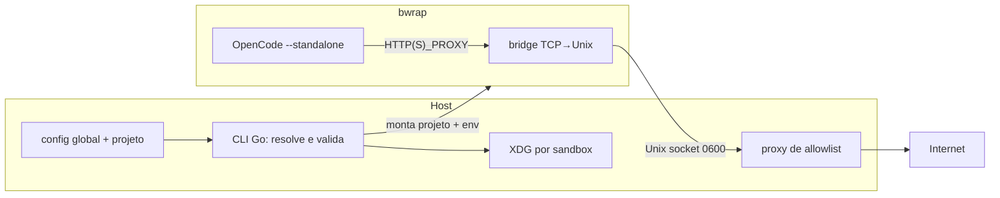

# RFC-0001: Sandbox de agentes em Go com política de rede e roteamento (v1)

- **Status:** Draft
- **Autor(es):** Gustavo
- **Revisores:** Gustavo (auto-revisão)
- **Data:** 2026-10-29
- **Prazo para feedback:** 2026-11-03
- **Revisão da decisão:** 2 semanas após o início do dogfood
- **ADR relacionada:** [ADR-0001](../adr/0001-sandbox-opencode-com-bwrap.md)
- **Substitui / Relacionadas:** [ADR-0002](../adr/0002-estado-e-credenciais-por-sandbox.md), [ADR-0003](../adr/0003-skills-pinadas-e-snapshot.md), [ADR-0004](../adr/0004-hooks-de-quality-gate.md); substituição: N/A
- **Origem:** ADR-0001 após o grill de 2026-10-29 (veredito: sólida com ressalvas; `allowlist` condicionado à matriz)

## 1. Resumo

Hoje o repositório tem apenas o script `opencode-sandbox`: ele isola filesystem e processos com `bwrap`, mas compartilha a rede do host, herda o ambiente e monta config/data do OpenCode em leitura/escrita. Propomos uma CLI em Go que resolve uma política declarativa por projeto (`host`/`none`/`allowlist`), aplica XDG próprio por sandbox, `--clearenv` e `--standalone`, e imprime a configuração resolvida.

A v1 cobre **rede/roteamento + isolamento mínimo de estado**. Skills, hooks e importação de credenciais ficam em ADRs próprias. O impacto esperado é reduzir dano acidental e prompt injection sem container, mantendo o custo de inicialização baixo.

## 2. Contexto e problema

O script atual resolve isolamento de filesystem e de processos, mas não controle de acesso:

- `opencode-sandbox:22-68` monta os argumentos do `bwrap`.
- `opencode-sandbox:38-45` mantém o projeto em leitura/escrita, usa `tmpfs` como `$HOME` e faz bind **gravável** de `~/.config/opencode`, `~/.local/share/opencode`, `~/.local/state/opencode` e `~/.cache/opencode`.
- `opencode-sandbox:57-63` isola PID, IPC, UTS e cgroup, com `--die-with-parent` e `--new-session`.
- `opencode-sandbox:6-20,53-55` gera um `resolv.conf` e o monta sobre o alvo real do symlink; **não** usa `--unshare-net`, portanto compartilha o namespace de rede do host.
- `opencode-sandbox:70-75` usa `--standalone` para o servidor do OpenCode subir dentro do sandbox, em vez de usar o serviço compartilhado do host.
- O banco global fica em `~/.local/share/opencode/opencode.db` (`opencode debug paths`), exposto pelos binds.
- Não há código da ferramenta, schema de configuração nem testes.

**Quem sente:** desenvolvedores que rodam agentes de código em repositórios locais e querem limitar rede, segredos e arquivos sem montar um container.

**Se nada mudar:** a escolha fica entre aceitar a rede do host, o ambiente herdado e o estado global gravável, ou não usar sandbox. O script dá uma sensação de isolamento que não cobre o que o agente acessa na rede e no ambiente.

**Modelo de ameaça:** escolhido pelo usuário. A recomendação forte é cobrir **dano acidental e prompt injection de agentes de LLM** em repositórios próprios; não é conter um atacante sofisticado que explore o kernel ou o host. A ferramenta entrega mecanismos de controle e um caminho de inicialização sem default inseguro.

> **Premissas não validadas:** a motivação padrão é uma escolha de produto, não uma métrica; npm/pip e bypass por NAT usermode ainda não foram testados; a descoberta de `.opencode` do projeto no OpenCode V2 não foi confirmada; a comparação com container/Podman é análise, não benchmark.

## 3. Objetivos e não-objetivos

**Objetivos:**

- **O1.** Config declarativa por projeto, com perfis nomeados, override por CLI e impressão da config resolvida antes de executar.
- **O2.** Três perfis de rede na v1: `host`, `none` e `allowlist`; no `allowlist`, bloquear egress direto, negar IPs privados/link-local/metadata, resolver DNS no proxy e impedir QUIC/IPv6 como caminho de fuga.
- **O3.** XDG próprio por sandbox, `--clearenv` + env allowlist e `--standalone`; nenhum bind gravável do estado global do OpenCode.
- **O4.** Backend único `bwrap`; Linux e WSL; CLI em Go, binário único, sem daemon.
- **O5.** Falhar com mensagem clara quando `bwrap` ou user namespaces não estiverem disponíveis.
- **O6.** Dogfood no próprio repositório e revisão da decisão 2 semanas após o início do dogfood.
- **O7.** `allowlist` só é liberado quando a matriz de fuga (incluindo npm/pip e NAT usermode) passar.

**Não-objetivos:**

- Container/Podman e imagem compartilhada na v1 (alternativa descartada; ver §6).
- Skills, hooks e importação de credenciais (`auth export/import`): ADR-0003, ADR-0004 e ADR-0002.
- macOS; política de mounts configurável; limites de CPU/memória; seccomp/AppArmor específico.
- Bridge L2, remoção da rede local e proxy transparente como default.
- Conter um agente comprometido além do que a política escolhida permite.
- GUI, marketplace de skills ou multi-tenant.

## 4. Requisitos e restrições

| Requisito | Tipo | Origem |
|---|---|---|
| Nenhum default implícito de rede; o init exige escolha | Inegociável | ADR-0001 |
| No perfil `allowlist`, egress direto é bloqueado | Inegociável | Promessa do produto |
| Segredos e estado global do host não são montados | Inegociável | ADR-0001 (v1) |
| `--standalone` para o servidor rodar dentro do sandbox | Inegociável | Spike de 2026-10-27 |
| Proxy é o único canal de rede no `allowlist` | Inegociável | Spike de 2026-10-27 |
| Socket do proxy `0600` em diretório privado/read-only; bridge read-only | Inegociável | Superfície de ataque do canal |
| Sem `/dev/net/tun`/NAT usermode e sem sockets do host além do proxy | Inegociável | Bypass da allowlist |
| Backend único `bwrap`; sem container na v1 | Inegociável | Decisão do grill (2026-10-29) |
| Linux + WSL | Inegociável | Escopo v1 |
| Config resolvida auditável | Inegociável | Controle/auditoria |
| Binário único em Go | Desejável | Stack escolhida |
| Config versionável: `asb.toml` no projeto + `$XDG_CONFIG_HOME/asb/config.toml` | Inegociável | Decisão de 2026-10-29 |
| Inicialização medida e registrada; sem meta numérica na v1 | Desejável | Uso interativo |
| npm/pip e NAT usermode na matriz automatizada | Gate | Liberação do `allowlist` |
| Allowlist base de env fechada (§5.4) | Inegociável | Decisão de 2026-10-29 |
| Runs sem root/daemon | Desejável | Driver de atrito |

## 5. Proposta

### 5.1 Visão geral



O host é a fonte de verdade (config e proxy). O sandbox recebe o projeto em leitura/escrita, um `$HOME` em `tmpfs` e um XDG próprio. No `allowlist`, o socket Unix do proxy é o único canal de saída; o `bwrap` não filtra domínio nem cria bridge, então proxy e bridge são fornecidos pela ferramenta.

### 5.2 Interface e configuração

- Binário: **`asb`**. Config global em `$XDG_CONFIG_HOME/asb/config.toml` (default `~/.config/asb/config.toml`).
- Config do projeto em **`asb.toml`** na raiz do repositório, versionável. TOML; `version = 1` obrigatório.
- **Precedência:** flag de CLI > `asb.toml` do projeto > config global > **nenhum default**. O primeiro uso sem perfil falha pedindo `host`, `none` ou `allowlist`.
- Listas (`network.allow`, `env.allow`) **substituem**, não fazem merge, entre níveis. Previsibilidade vale mais que herança implícita.
- Flags de CLI apenas sobrescrevem a config; o `asb` imprime a **config resolvida** (perfil, domínios, env, caminhos XDG) antes de executar e em `asb --print-config`.
- OpenCode roda com **`--standalone`**: o servidor que executa ferramentas sobe dentro do `bwrap` e recebe o ambiente de proxy.
- Schema da v1:

```toml
version = 1

[network]
profile = "allowlist"   # host | none | allowlist
allow = [               # só para profile = "allowlist"; nomes de host
  "github.com",
  "registry.npmjs.org",
  "pypi.org",
  "files.pythonhosted.org",
]

[env]
allow = ["PATH", "TERM", "LANG", "LC_ALL", "TZ", "USER", "LOGNAME", "SHELL"]
from_file = ".asb.env"  # opcional; não versionado, 0600; uma VAR=valor por linha
```

- `HOME` é definido pela ferramenta para o `$HOME` efêmero do sandbox, não pelo usuário.
- `deny_private` não é configurável na v1: negar IP privado, link-local, metadata e loopback é fixo. Host não permitido falha fechado; não existe "allow all" implícito.
- `from_file` é opcional; se existir, precisa de permissão `0600` e o arquivo deve estar no `.gitignore`. Segredos nunca vão para `asb.toml` versionado.

### 5.3 Política de rede

| Perfil | Implementação | Garantia | Uso típico |
|---|---|---|---|
| `host` | Namespace de rede do host | Nenhuma restrição de rede | Compatibilidade total, tarefas confiáveis |
| `none` | `--unshare-net` | Só loopback | Trabalho offline, modelos locais |
| `allowlist` | Namespace isolado + proxy que impõe a lista | Só destinos permitidos; egress direto bloqueado | Uso padrão com controle |

No `allowlist`:

- O proxy é o único caminho de saída; todo o resto é bloqueado (TCP, UDP, IPv6).
- Nenhum socket Unix do host além do proxy; `/run` e `/tmp` são `tmpfs`.
- IPs privados, link-local, metadata e loopback do host são negados; a v1 não tem exceção configurável.
- DNS é resolvido pelo proxy; DNS direto não é permitido.
- QUIC/UDP 443 é bloqueado; o tráfego precisa cair em TCP/proxy.
- A lista é por **nome de destino**, não por IP; destino que resolve para IP privado é rejeitado (proteção contra DNS rebinding).
- O proxy não faz MITM: filtra por hostname (CONNECT), não por path. Qualquer domínio permitido é um canal de saída; a política deve ser mínima.
- `NO_PROXY=localhost,127.0.0.1,::1` para o serviço local do OpenCode; `NODE_USE_ENV_PROXY=1` para toolchains Node.
- O binário Go tem subcomandos internos `proxy` e `bridge`; a bridge é o mesmo binário montado read-only no sandbox.
- Sem `/dev/net/tun`; `mknod`/device cgroup bloqueado para impedir NAT usermode (`slirp4netns`/`pasta`).
- Proxy transparente com nftables **não faz parte da v1**; só reabre com evidência de ferramenta que ignora proxy explícito e uma ADR própria.
- A bridge TCP→Unix socket faz parte da v1. Bridge L2 e remoção da rede local ficam fora.

**Matriz executada em 2026-10-29** (spike com proxy/bridge em Python; `bwrap 0.13.1`, `curl`, `git`, `pip 26.2.1`, `npm 12.2.1`, `node 26.12.1`):

| Teste | Resultado |
|---|---|
| netns sem rota (`ip route` e `ip -6 route` vazios) | só `lo`; DNS direto falha |
| `curl` direto IPv4 e IPv6 (`--noproxy '*'`) | sem rota |
| `curl` em domínio permitido | 200 |
| `curl` em domínio negado | 403 |
| `curl` em `169.254.169.254` | 403 |
| hostname público resolvendo para loopback (`127.0.0.1.nip.io`) | 403 |
| UDP para `8.8.8.8:443` (QUIC) | `Network is unreachable` |
| `git ls-remote` via proxy | ok |
| `pip install six` via proxy | ok |
| `npm install is-number` via proxy | ok |
| `node fetch` com `NODE_USE_ENV_PROXY=1` | 200; sem a flag, falha |
| `/dev/net/tun` | ausente |
| `mknod` de char device `10:200` | negado |
| capabilities (`CapBnd`) | `0` |
| `unshare -Urn` dentro do sandbox | **permitido** (userns aninhado; sem `/dev/net/tun` e sem device não há caminho de rede) |
| helpers `slirp4netns`/`pasta`/`rootlesskit` | ausentes no ambiente |
| XDG próprio (`opencode debug paths`) | respeita `XDG_*`; estado do host invisível |

O proxy da v1 resolve **apenas IPv4** e falha fechado para host que só tenha AAAA. Isso é intencional: evita abrir um caminho IPv6 que o netns não controla.

**Gate:** a v1 pode ser dogfoodada com `host`/`none`; `allowlist` só é anunciado como pronto quando a **matriz automatizada em CI** repetir estes resultados e cobrir as toolchains da Fase 2. npm/pip e NAT usermode passaram manualmente em 2026-10-29; o gate deixa de ser "testar npm/pip" e passa a ser "automatizar a matriz". O spike usou proxy/bridge mínimos em Python; a implementação Go precisa repetir a matriz e cobrir parsing, timeouts, queda do proxy no meio da sessão e erros de rede.

### 5.4 Estado, ambiente e credenciais

- **XDG próprio por sandbox:** `XDG_CONFIG_HOME`, `XDG_DATA_HOME`, `XDG_STATE_HOME` e `XDG_CACHE_HOME` apontam para `$XDG_STATE_HOME/asb/sandboxes/<id>/opencode/{config,data,state,cache}`.
- `<id>` = `<basename-do-projeto>-<sha256(caminho-absoluto)[0:8]>`; `--sandbox-id` sobrescreve. Limpeza, rotação e modo efêmero ficam na ADR-0002.
- Nenhum bind gravável de `~/.config/opencode`, `~/.local/share/opencode`, `~/.local/state/opencode`, `~/.cache/opencode` ou `opencode.db`.
- `--clearenv` no sandbox. A allowlist base da v1 é fixa: `PATH`, `TERM`, `LANG`, `LC_ALL`, `TZ`, `USER`, `LOGNAME`, `SHELL`; `HOME` é definido pela ferramenta e as variáveis de proxy são definidas pela ferramenta, não herdadas.
- Ficam de fora por default, mesmo que existam no host: `SSH_AUTH_SOCK`, `GPG_AGENT_INFO`, `DISPLAY`, `XAUTHORITY`, `DBUS_SESSION_BUS_ADDRESS`, `AWS_*`, `GITHUB_TOKEN`, `NPM_TOKEN` e qualquer `*_TOKEN`/`*_KEY`. Entram apenas por `[env] allow` ou `from_file`.
- Validado no spike de 2026-10-29: OpenCode, git, node, npm e pip funcionaram com essa base, sem variável extra.
- `--standalone` obrigatório; o serviço compartilhado do host nunca é usado.
- Credenciais na v1: login dentro do XDG do sandbox, uma vez por sandbox. `opencode auth export/import`, modo efêmero, rotação e limpeza ficam na ADR-0002.
- O agente lê as credenciais do próprio sandbox — necessário para o provider. O que se elimina é o acesso ao estado global do host.

### 5.5 Filesystem, plataformas e stack

- v1 mantém o perfil do script: sistema somente leitura, `$HOME` em `tmpfs`, projeto em leitura/escrita. Mounts configuráveis ficam para depois.
- Linux + WSL. macOS fora; `bwrap` não existe lá.
- CLI em Go, binário único, sem daemon.

### 5.6 Falhas e preflight

- `bwrap` ausente ou user namespaces desabilitados: falhar antes de executar, com mensagem clara e link para troubleshooting.
- Proxy indisponível ou socket inacessível: falhar fechado (não cair para `host`).
- DNS quebrado em WSL: detectar e reportar; teste automatizado do `resolv.conf`.
- A config resolvida é impressa mesmo em caso de falha de preflight, para auditoria.

## 6. Alternativas consideradas

| Critério | Proposta (bwrap) | Container/Podman | Imagem compartilhada + Podman | Só config do OpenCode | Não fazer nada |
|---|---|---|---|---|---|
| Isolamento de filesystem/processos | Bom | Bom | Bom | Nenhum | Nenhum |
| Controle de rede | Bom (proxy explícito; npm/pip validados) | Bom (proxy também necessário) | Bom (proxy também necessário) | Nenhum | Nenhum |
| Sem root/daemon | Bom | Médio/ruim | Médio/ruim | Bom | Bom |
| Startup | Bom | Médio | Médio | Bom | Bom |
| Build/storage | Nenhum | Imagem | 1 imagem reutilizada | Nenhum | Nenhum |
| WSL | Bom | Rootless exige setup | Rootless exige setup | Bom | Bom |
| Reprodutibilidade | Baixa (host) | Alta | Alta | Média | Ruim |

**Container/Podman (melhor alternativa):** entrega namespaces, limites de recursos e imagem reproduzível, mas **não entrega allowlist por domínio sozinho** — precisaria do mesmo proxy. Perde em atrito (daemon/rootless, bind mount, UID) e em velocidade. Descartado para a v1; continua como fallback se a matriz achar bypass não mitigável.

**Imagem compartilhada + Podman (padrão `openyolo`):** uma imagem única com opencode, skills, MCPs e toolchains, reutilizada entre repositórios, com o projeto montado. O build é único por versão, não por repo. Ainda assim: não resolve allowlist, adiciona runtime/volume/setup rootless, e a imagem vira fronteira de supply chain; copiar a config do host para a imagem arrisca segredo na layer. Descartada para a v1.

**Só config do OpenCode:** não entrega controle de acesso; comandos rodam com o usuário do host.

**Manter o script:** a lógica de rede/perfis vira shell difícil de testar; foi o limite que o script único já mostrou.

**Não fazer nada:** mantém a rede do host, o ambiente herdado e o estado global gravável.

**Proxy transparente:** não faz parte da v1; só entra com evidência de ferramenta que ignora `HTTP(S)_PROXY`, porque exige privilégio e mais superfície.

## 7. Riscos e mitigações

| Risco | Prob. | Impacto | Mitigação | Gatilho de reversão |
|---|---|---|---|---|
| Fuga da allowlist por IP direto, DNS, QUIC, IPv6 ou rebinding | Baixa/média | Alto | `--unshare-net` sem rota, proxy como único egress, negar IPs privados/link-local/metadata, DNS no proxy, matriz de fuga | Qualquer fuga não bloqueada → container/VM |
| Exfiltração para domínio permitido | Média | Alto | Lista mínima, revisão da política, documentar que a allowlist é por hostname e não por conteúdo | Incidente → revisar política |
| OpenCode conecta ao serviço do host e executa fora do sandbox | Baixa | Alto | `--standalone` obrigatório, XDG/serviço por sandbox, teste da árvore de processos | Serviço não for filho do `bwrap` → bloquear release |
| Agente altera config/data/credenciais globais do host | Baixa | Alto | Nenhum bind global, XDG por sandbox, `--clearenv`, teste de escrita | Qualquer escrita no host → bloquear release |
| Proxy comprometido ou socket/bridge adulterado | Baixa | Alto | Código pequeno, sem MITM, socket `0600` em diretório privado/read-only, bridge read-only, testes | Vulnerabilidade no proxy → corrigir ou cair para container/VM |
| Bypass por NAT usermode (`slirp4netns`, `pasta`, `rootlesskit`) | Baixa | Alto | Sem `/dev/net/tun`, `mknod`/device cgroup bloqueado, sem sockets do host; `unshare -Urn` é permitido, mas sem device não cria egress; teste com helpers instalados | Helper criar tap/rota → bloquear release |
| `bwrap`/user namespaces restritos | Média | Alto | Preflight e mensagem clara | Ambiente incompatível → documentar/fallback |
| DNS quebrado em WSL | Média | Médio | Teste automatizado do `resolv.conf` | Regressão → bloquear release |
| Env base insuficiente quebra OpenCode/toolchains | Média | Médio | Lista base explícita, teste de fumaça, mensagem clara | Ferramenta não sobe → corrigir lista |
| Credenciais do sandbox legíveis pelo agente e em disco | Média | Alto | Mínimo necessário, sem importação do host na v1, rotação/efêmero na ADR-0002, revogação rápida | Vazamento → rotacionar e reduzir escopo |
| Falso senso de segurança | Alta | Alto | Documentar o que cada perfil garante/não garante; default exige escolha; CI autoritativo | Uso indevido → reforçar docs/CI |
| Inicialização lenta | Média | Baixo | Medir e registrar (sem meta numérica na v1); baseline de 2026-10-29: ~5 ms `bwrap`, ~110 ms bridge em Python, ~0,40 s `opencode --version` no sandbox | Regressão em relação ao baseline → investigar |

## 8. Plano de migração e rollout

1. **Fase 0 — spike de rede (concluída em 2026-10-27; matriz repetida em 2026-10-29):** proxy explícito via Unix socket + `--unshare-net` escolhido; curl, git, node, npm, pip e OpenCode validados; NAT usermode sem caminho de egress com o perfil atual. Falta automatizar a matriz.
2. **Fase 1 — CLI `asb` + `asb.toml` + `host`/`none` + XDG/`--clearenv`/`--standalone`:** substituir o script por um wrapper que chama a CLI. Dogfood com `host`/`none`.
3. **Fase 2 — `allowlist` + matriz:** implementar o proxy/bridge em Go, repetir a matriz em CI, incluindo npm, pip, netns aninhado e NAT usermode. Só liberar `allowlist` quando passar.
4. **Fase 3 — dogfood + revisão:** 2 semanas de dogfood no repositório; revisão da decisão 2 semanas após o início do dogfood.

**Migração do script:** `opencode-sandbox` vira um wrapper que executa `asb run "$@"`. Se `asb` não estiver no `PATH`, o wrapper falha com instrução de instalação — **não** cai silenciosamente para o comportamento antigo. O script atual fica preservado no commit `8d97c44`; não há migração de dados.

**Compatibilidade:** sem `asb.toml`, o wrapper usa `--profile host` e avisa que é o comportamento legado; a config é aditiva e versionada.

**Rollback:** restaurar o script do commit `8d97c44`, desligar `allowlist`, manter a config. Irreversível: nada além do formato de config, que pode ser versionado.

**Fora do plano:** container/Podman e imagem compartilhada. Se a matriz achar bypass não mitigável, abrir uma ADR nova para container/VM em vez de reintroduzir Podman na v1.

## 9. Impacto

- **Operação:** novo binário Go, proxy no host durante sessões `allowlist`, XDG por sandbox e `--standalone`. Sem daemon.
- **Custo** (T-shirt por entregável, sem estimativa em dias):

  | Entregável | Tamanho |
  |---|---|
  | CLI `asb`, config `asb.toml`, precedência e `--print-config` | M |
  | Perfil `bwrap` (XDG, `--clearenv`, `--standalone`) | P |
  | Proxy CONNECT + allowlist + DNS | M |
  | Bridge TCP→Unix em Go | P |
  | Matriz de fuga automatizada em CI | M |
  | Docs e troubleshooting (WSL, proxy, env) | P |
  | **Total** | **M** (dois M + três P) |

  Tamanhos relativos entre si; não são dias nem prazo.
- **Segurança:** melhora o controle de rede e o isolamento de estado; a allowlist é por hostname, não por conteúdo; sem seccomp/limites de recursos; hooks não são gate (fora da v1).
- **Performance:** medido em 2026-10-29: `bwrap` ~5 ms; bridge em Python ~110 ms (o bridge em Go deve reduzir); `opencode --version` ~0,40 s no sandbox vs ~0,29 s no host. Sem meta numérica na v1: a ferramenta mede e registra o startup; regressão em relação ao baseline é investigada.
- **Outros times:** nenhum. O script é consumido só neste repositório (commit `8d97c44`); não há CI nem outro projeto que dependa dele.
- **Documentação/treinamento:** referência de config, o que cada perfil garante/não garante, troubleshooting de WSL, proxy, `--clearenv` e `NODE_USE_ENV_PROXY`.

## 10. Métricas de sucesso e revisão

- Matriz de fuga passa 100% no perfil `allowlist` (incluindo IPv6, QUIC, DNS, rebinding, npm, pip e NAT usermode).
- `none` não tem nenhuma conexão externa; `host` mantém compatibilidade.
- Nenhuma escrita do agente em config/data/state/cache global do host nem no `opencode.db`.
- O servidor do OpenCode é filho do `bwrap` em todas as sessões (`--standalone`), nunca o serviço compartilhado do host.
- `--clearenv`: variável não declarada não existe; declarada existe.
- Socket do proxy em diretório privado/read-only; bridge read-only; agente não altera o canal.
- Config resolvida impressa em toda sessão.
- Dogfood no repositório por 2 semanas, responsável Gustavo, sem regressão bloqueante.
- Tempo de inicialização medido e registrado a cada release; sem meta numérica na v1. Baseline de 2026-10-29 registrado em §9.
- Reavaliar 2 semanas após o início do dogfood; reverter para container/VM se houver fuga não mitigável, comprometimento do proxy ou incompatibilidade de proxy inaceitável.
- **Gate:** `allowlist` só é anunciado como pronto quando a matriz automatizada em CI passar (npm, pip, netns aninhado e NAT usermode); até lá, o dogfood usa `host`/`none`.

## 11. Questões em aberto

**Resolvidas nesta revisão (2026-10-29):**

| # | Questão | Resolução | Evidência |
|---|---|---|---|
| 1 | npm e pip via proxy explícito | Ambos funcionam com `HTTPS_PROXY`, sem configuração extra | `pip 26.2.1` (`six`) e `npm 12.2.1` (`is-number`) |
| 2 | Bypass por NAT usermode | Sem caminho com o perfil atual: `/dev/net/tun` ausente, `mknod` negado, sem helpers; `unshare -Urn` não cria egress sem device | Matriz de 2026-10-29 |
| 3 | Proxy transparente como fallback | Fora da v1; só reabre com ferramenta que ignore proxy explícito e evidência de quebra | ADR-0001 e §5.3 |
| 4 | Formato, nome e precedência do config | `asb.toml` + `$XDG_CONFIG_HOME/asb/config.toml`; TOML `version = 1`; CLI > projeto > global; listas substituem | §5.2 |
| 5 | Migração do script | `opencode-sandbox` vira wrapper de `asb run`; falha se `asb` não existir; script antigo no commit `8d97c44` | §8 |
| 7 | Alvo de tempo de inicialização | Sem meta numérica; medir e registrar | §9 |
| 8 | Go como stack | Mantida: binário único, sem daemon | ADR-0001 |
| 9 | Allowlist base de env | 8 variáveis + `HOME` e proxy definidos pela ferramenta | §5.4 |

**Ainda abertas:**

| # | Questão | Dono | Bloqueia? | Prazo |
|---|---|---|---|---|
| 1 | Toolchains além de npm/pip/node (Go, Rust, Java) na matriz | Gustavo | Não; cobre na Fase 2 | início do dogfood |
| 2 | Comportamento quando o proxy cai no meio da sessão: falhar fechado, retry ou encerrar | Gustavo | Não | Fase 2 |
| 3 | Credenciais: login por sandbox vs. `auth export/import` (ADR-0002) | Gustavo | Não para a v1 | ADR-0002 |

Nenhuma questão bloqueia o desenho da v1. O release do `allowlist` depende da matriz automatizada, não de uma decisão pendente.

## 12. Perguntas para os revisores

1. A matriz cobre os caminhos realistas? Falta Go, Rust, Java, IPv6 global, bypass de proxy por variável ou outra toolchain?
2. `unshare -Urn` permitido dentro do sandbox é risco aceitável, dado que não há `/dev/net/tun` nem device? Existe caminho com `CAP_NET_ADMIN` que não consideramos?
3. Arrays de `network.allow` e `env.allow` que substituem (em vez de merge) entre global/projeto são previsíveis o suficiente?
4. O proxy IPv4-only, falhando fechado para hosts AAAA-only, é aceitável na v1?
5. O wrapper `opencode-sandbox` deve falhar sem `asb` ou cair para o comportamento antigo por um release?
6. O gate de `allowlist` baseado na matriz automatizada está no ponto certo, ou deveria exigir revisão manual da política?
7. O desenho do proxy/bridge (CONNECT por hostname, sem MITM, DNS no proxy, socket `0600`, bridge read-only) tem algum furo óbvio?

## 13. Referências

- [ADR-0001](../adr/0001-sandbox-opencode-com-bwrap.md) — decisão da v1
- [ADR-0002](../adr/0002-estado-e-credenciais-por-sandbox.md), [ADR-0003](../adr/0003-skills-pinadas-e-snapshot.md), [ADR-0004](../adr/0004-hooks-de-quality-gate.md)
- `opencode-sandbox` (mounts, namespaces e DNS): `opencode-sandbox:6-20,22-68,38-45,53-63,70-75`
- Commit `8d97c44` (script base)
- `opencode` v2.1.4 — `--standalone`, `auth export/import`, `service`; `opencode debug paths` e `opencode debug config` (verificado neste ambiente)
- `bwrap` 0.13.1 (`man bwrap`)
- [XDG Base Directory Specification](https://specifications.freedesktop.org/basedir-spec/latest/)
- [bubblewrap](https://github.com/containers/bubblewrap)
- [openyolo](https://github.com/gustavoxffff/openyolo) — alternativa de imagem compartilhada avaliada e descartada
- OpenCode V2 — [Config](https://opencode.ai/v2/docs/config), [Network](https://opencode.ai/v2/docs/network), [Providers](https://opencode.ai/v2/docs/providers)
- Spike de rede de 2026-10-27, registrado na ADR-0001 (§ Política de rede)
- Matriz de fuga de 2026-10-29 (proxy/bridge em Python; artefatos não versionados): npm 12.2.1, pip 26.2.1, node 26.12.1, git e curl
- `asb.toml` e a precedência definidos em §5.2; medições de startup em §9
