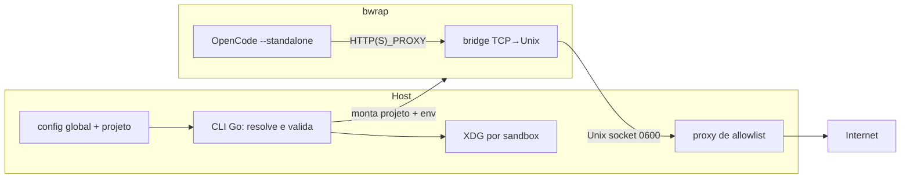

# RFC-0001: Sandbox de agentes em Go com política de rede e roteamento (v1)

- **Status:** Draft (revisão de 2026-11-01)
- **Autor(es):** Gustavo
- **Revisores:** Gustavo (auto-revisão)
- **Data:** 2026-10-29 (criação); 2026-11-01 (revisão do grill)
- **Prazo para feedback:** 2026-11-03
- **Revisão da decisão:** 2 semanas após o início do dogfood, que começa depois do gate do `allowlist`
- **ADR relacionada:** [ADR-0001](../adr/0001-sandbox-opencode-com-bwrap.md)
- **Substitui / Relacionadas:** [ADR-0002](../adr/0002-estado-e-credenciais-por-sandbox.md), [ADR-0003](../adr/0003-skills-pinadas-e-snapshot.md), [ADR-0004](../adr/0004-hooks-de-quality-gate.md); substituição: N/A
- **Origem:** ADR-0001 após o grill de 2026-10-29 e a revisão de 2026-11-01 (veredito: sólida com ressalvas; `allowlist` condicionado à matriz completa)

## 1. Resumo

O ponto de partida era o script `opencode-sandbox`: ele isola filesystem e processos com `bwrap`, mas compartilha a rede do host, herda o ambiente e monta config/data do OpenCode em leitura/escrita. Propomos uma CLI em Go que resolve uma política declarativa por projeto (`host`/`none`/`allowlist`), aplica XDG próprio por sandbox, `--clearenv` e `--standalone`, e imprime a configuração resolvida.

A v1 cobre **rede/roteamento + isolamento mínimo de estado**. O wrapper e o comportamento legado são removidos: o usuário chama `asb run` diretamente. Valores de ambiente não vão no argv do `bwrap`; o `~/.gitconfig` do host não é montado; e o `allowlist` só é liberado com a matriz completa. Skills, hooks e importação de credenciais ficam em ADRs próprias. O impacto esperado é reduzir dano acidental e prompt injection sem container, mantendo o custo de inicialização baixo.

## 2. Contexto e problema

O script legado (`opencode-sandbox`, removido na v1) resolve isolamento de filesystem e de processos, mas não controle de acesso:

- `opencode-sandbox:22-68` monta os argumentos do `bwrap`.
- `opencode-sandbox:38-45` mantém o projeto em leitura/escrita, usa `tmpfs` como `$HOME` e faz bind **gravável** de `~/.config/opencode`, `~/.local/share/opencode`, `~/.local/state/opencode` e `~/.cache/opencode`.
- `opencode-sandbox:57-63` isola PID, IPC, UTS e cgroup, com `--die-with-parent` e `--new-session`.
- `opencode-sandbox:6-20,53-55` gera um `resolv.conf` e o monta sobre o alvo real do symlink; **não** usa `--unshare-net`, portanto compartilha o namespace de rede do host.
- `opencode-sandbox:70-75` usa `--standalone` para o servidor do OpenCode subir dentro do sandbox, em vez de usar o serviço compartilhado do host.
- O banco global fica em `~/.local/share/opencode/opencode.db` (`opencode debug paths`), exposto pelos binds.
- Não há código da ferramenta, schema de configuração nem testes.

**Quem sente:** desenvolvedores que rodam agentes de código em repositórios locais e querem limitar rede, segredos e arquivos sem montar um container.

**Se nada mudar:** a escolha fica entre aceitar a rede do host, o ambiente herdado e o estado global gravável, ou não usar sandbox. O script dá uma sensação de isolamento que não cobre o que o agente acessa na rede e no ambiente.

**Modelo de ameaça:** escolhido pelo usuário. A recomendação forte é cobrir **dano acidental e prompt injection de agentes de LLM** em repositórios próprios; não é conter um atacante sofisticado que explore o kernel ou o host. A ferramenta entrega mecanismos de controle e um caminho de inicialização sem default inseguro.

> **Premissas não validadas:** a motivação padrão é uma escolha de produto, não uma métrica; WSL não tem runner automatizado; a descoberta de `.opencode` do projeto no OpenCode V2 não foi confirmada (fora da v1); a comparação com container/Podman é análise, não benchmark. npm/pip passaram manualmente em 2026-10-29; NAT usermode foi parcialmente testado e precisa entrar na matriz.

## 3. Objetivos e não-objetivos

**Objetivos:**

- **O1.** Config declarativa por projeto, com perfis nomeados, override por CLI e impressão da config resolvida antes de executar.
- **O2.** Três perfis de rede na v1: `host`, `none` e `allowlist`; no `allowlist`, bloquear egress direto, negar IPs privados/link-local/metadata, resolver DNS no proxy e impedir QUIC/IPv6 como caminho de fuga.
- **O3.** XDG próprio por sandbox, `--clearenv` + env allowlist e `--standalone`; nenhum bind gravável do estado global do OpenCode.
- **O4.** Backend único `bwrap`; Linux e WSL; CLI em Go, binário único, sem daemon.
- **O5.** Falhar com mensagem clara quando `bwrap` ou user namespaces não estiverem disponíveis.
- **O6.** Dogfood no próprio repositório, começando após o gate do `allowlist`, com revisão da decisão 2 semanas depois.
- **O7.** `allowlist` só é liberado quando a matriz de fuga completa passar: curl, git, Node, OpenCode, npm, pip, IPv6, QUIC, DNS rebinding, NAT usermode, `--clearenv`, `--standalone` e escrita no host.
- **O8.** Segredos de `env.allow`/`from_file` não aparecem no argv do `bwrap`; são entregues por fd/arquivo efêmero lido por `asb exec`.
- **O9.** O `~/.gitconfig` do host não é montado; `[git] mode = minimal`/`manual`/`off` controla o que entra.
- **O10.** O wrapper `opencode-sandbox` e o fallback legado são removidos; não há `--profile host` implícito.

**Não-objetivos:**

- Container/Podman e imagem compartilhada na v1 (alternativa descartada; ver §6).
- Skills, hooks e importação de credenciais (`auth export/import`): ADR-0003, ADR-0004 e ADR-0002.
- macOS; política de mounts configurável; limites de CPU/memória; seccomp/AppArmor específico.
- Bridge L2, remoção da rede local e proxy transparente como default.
- Conter um agente comprometido além do que a política escolhida permite.
- GUI, marketplace de skills ou multi-tenant.

## 4. Requisitos e restrições

| Requisito | Tipo | Origem |
|---|---|---|
| Nenhum default implícito de rede; o init exige escolha | Inegociável | ADR-0001 |
| Wrapper/legado removido; sem `--profile host` implícito | Inegociável | Revisão de 2026-11-01 |
| No perfil `allowlist`, egress direto é bloqueado | Inegociável | Promessa do produto |
| Segredos e estado global do host não são montados | Inegociável | ADR-0001 (v1) |
| Segredos de `env.allow`/`from_file` não vão no argv do `bwrap` | Inegociável | Revisão de 2026-11-01 |
| `~/.gitconfig` do host não é montado; `[git]` controla o que entra | Inegociável | Revisão de 2026-11-01 |
| `--standalone` para o servidor rodar dentro do sandbox | Inegociável | Spike de 2026-10-27 |
| Proxy é o único canal de rede no `allowlist` | Inegociável | Spike de 2026-10-27 |
| Socket do proxy `0600` em diretório privado/read-only; bridge read-only | Inegociável | Superfície de ataque do canal |
| Socket em `XDG_RUNTIME_DIR` ou `/tmp/asb-<uid>/<hash>`; nunca `/tmp/asb` | Inegociável | Revisão de 2026-11-01 |
| Sem `/dev/net/tun`/NAT usermode e sem sockets do host além do proxy | Inegociável | Bypass da allowlist |
| Backend único `bwrap`; sem container na v1 | Inegociável | Decisão do grill (2026-10-29) |
| Linux + WSL | Inegociável | Escopo v1 |
| Config resolvida auditável | Inegociável | Controle/auditoria |
| Binário único em Go | Desejável | Stack escolhida |
| Config versionável: `asb.toml` no projeto + `$XDG_CONFIG_HOME/asb/config.toml` | Inegociável | Decisão de 2026-10-29 |
| Inicialização medida em duas partes (setup e até o comando); sem meta numérica na v1 | Desejável | Uso interativo |
| Matriz completa: git, Node, OpenCode, rebinding, NAT, `--clearenv`, `--standalone`, escrita no host e segredos no argv | Gate | Liberação do `allowlist` |
| Allowlist base de env fechada (§5.4) | Inegociável | Decisão de 2026-10-29 |
| Runs sem root/daemon | Desejável | Driver de atrito |

## 5. Proposta

### 5.1 Visão geral



O host é a fonte de verdade (config e proxy). O sandbox recebe o projeto em leitura/escrita, um `$HOME` em `tmpfs` e um XDG próprio. No `allowlist`, o socket Unix do proxy é o único canal de saída; o `bwrap` não filtra domínio nem cria bridge, então proxy e bridge são fornecidos pela ferramenta.

### 5.2 Interface e configuração

- Binário: **`asb`**. Config global em `$XDG_CONFIG_HOME/asb/config.toml` (default `~/.config/asb/config.toml`).
- Config do projeto em **`asb.toml`** na raiz do repositório, versionável. TOML; `version = 1` obrigatório.
- **Precedência:** flag de CLI > `asb.toml` do projeto > config global > **nenhum default**. O primeiro uso sem perfil falha pedindo `host`, `none` ou `allowlist`. Sem `asb.toml` e sem `--profile`, `asb run` falha; não há wrapper nem fallback legado.
- Listas (`network.allow`, `env.allow`, `git.keys`) **substituem**, não fazem merge, entre níveis. Previsibilidade vale mais que herança implícita.
- Flags de CLI apenas sobrescrevem a config; o `asb` imprime a **config resolvida** (perfil, domínios, env, caminhos XDG, git) antes de executar e em `asb --print-config`.
- OpenCode roda com **`--standalone`**: o servidor que executa ferramentas sobe dentro do `bwrap` e recebe o ambiente de proxy.
- Valores de `env.allow`/`from_file` **não vão no argv do `bwrap`**: são entregues por fd/arquivo efêmero lido por `asb exec`, que remove o arquivo antes do exec. `--setenv` fica restrito a `HOME`, XDG e proxy definidos pela ferramenta.
- Schema da v1:

```toml
version = 1

[network]
profile = "allowlist"   # host | none | allowlist
allow = [               # só para profile = "allowlist"; nomes de host
  "github.com",
  "registry.npmjs.org",
  "pypi.org",
  "files.pythonhosted.org",
]

[env]
allow = ["PATH", "TERM", "LANG", "LC_ALL", "TZ", "USER", "LOGNAME", "SHELL"]
from_file = ".asb.env"  # opcional; não versionado, 0600; uma VAR=valor por linha

[git]
mode = "minimal"        # minimal | manual | off
# manual: chaves copiadas do ~/.gitconfig do host
keys = ["user.name", "user.email", "init.defaultBranch"]
```

- `HOME` é definido pela ferramenta para o `$HOME` efêmero do sandbox, não pelo usuário.
- `deny_private` não é configurável na v1: negar IP privado, link-local, metadata e loopback é fixo. Host não permitido falha fechado; não existe "allow all" implícito.
- `from_file` é opcional; se existir, precisa de permissão `0600` e o arquivo deve estar no `.gitignore`. Segredos nunca vão para `asb.toml` versionado nem para o argv do `bwrap`.
- `[git] mode = "minimal"` copia apenas `user.name`, `user.email` e `init.defaultBranch` do `~/.gitconfig` do host. `manual` copia apenas as chaves em `keys`. `off` não gera arquivo. O `~/.gitconfig` do host nunca é montado.

### 5.3 Política de rede

| Perfil | Implementação | Garantia | Uso típico |
|---|---|---|---|
| `host` | Namespace de rede do host | Nenhuma restrição de rede | Compatibilidade total, tarefas confiáveis |
| `none` | `--unshare-net` | Só loopback | Trabalho offline, modelos locais |
| `allowlist` | Namespace isolado + proxy que impõe a lista | Só destinos permitidos; egress direto bloqueado | Uso padrão com controle |

No `allowlist`:

- O proxy é o único caminho de saída; todo o resto é bloqueado (TCP, UDP, IPv6).
- Nenhum socket Unix do host além do proxy; `/run` e `/tmp` são `tmpfs`.
- IPs privados, link-local, metadata e loopback do host são negados; a v1 não tem exceção configurável.
- DNS é resolvido pelo proxy; DNS direto não é permitido.
- QUIC/UDP 443 é bloqueado; o tráfego precisa cair em TCP/proxy.
- A lista é por **nome de destino**, não por IP; destino que resolve para IP privado é rejeitado (proteção contra DNS rebinding).
- O proxy não faz MITM: filtra por hostname (CONNECT), não por path. Qualquer domínio permitido é um canal de saída; a política deve ser mínima.
- `NO_PROXY=localhost,127.0.0.1,::1` para o serviço local do OpenCode; `NODE_USE_ENV_PROXY=1` para toolchains Node.
- O binário Go tem subcomandos internos `proxy` e `bridge`; a bridge é o mesmo binário montado read-only no sandbox.
- Sem `/dev/net/tun`; `mknod`/device cgroup bloqueado para impedir NAT usermode (`slirp4netns`/`pasta`).
- Proxy transparente com nftables **não faz parte da v1**; só reabre com evidência de ferramenta que ignora proxy explícito e uma ADR própria.
- A bridge TCP→Unix socket faz parte da v1. Bridge L2 e remoção da rede local ficam fora.

**Matriz executada em 2026-10-29** (spike com proxy/bridge em Python; `bwrap 0.13.1`, `curl`, `git`, `pip 26.2.1`, `npm 12.2.1`, `node 26.12.1`):

| Teste | Resultado |
|---|---|
| netns sem rota (`ip route` e `ip -6 route` vazios) | só `lo`; DNS direto falha |
| `curl` direto IPv4 e IPv6 (`--noproxy '*'`) | sem rota |
| `curl` em domínio permitido | 200 |
| `curl` em domínio negado | 403 |
| `curl` em `169.254.169.254` | 403 |
| hostname público resolvendo para loopback (`127.0.0.1.nip.io`) | 403 |
| UDP para `8.8.8.8:443` (QUIC) | `Network is unreachable` |
| `git ls-remote` via proxy | ok |
| `pip install six` via proxy | ok |
| `npm install is-number` via proxy | ok |
| `node fetch` com `NODE_USE_ENV_PROXY=1` | 200; sem a flag, falha |
| `/dev/net/tun` | ausente |
| `mknod` de char device `10:200` | negado |
| capabilities (`CapBnd`) | `0` |
| `unshare -Urn` dentro do sandbox | **permitido** (userns aninhado; sem `/dev/net/tun` e sem device não há caminho de rede) |
| helpers `slirp4netns`/`pasta`/`rootlesskit` | ausentes no ambiente |
| XDG próprio (`opencode debug paths`) | respeita `XDG_*`; estado do host invisível |

O proxy da v1 resolve **apenas IPv4** e falha fechado para host que só tenha AAAA. Isso é intencional: evita abrir um caminho IPv6 que o netns não controla.

**Cobertura atual do `scripts/matrix.sh`:** o script cobre `none` (rotas IPv4/IPv6 vazias, curl externo, DNS direto, `/dev/net/tun`, `mknod` e `CapBnd`), `host` (curl em domínio permitido) e `allowlist` (domínio permitido/negado, metadata, IP direto, QUIC, rotas, `unshare -Urn` e npm/pip quando instalados em `/usr`). Ele **não** cobre git, Node, OpenCode, DNS rebinding, NAT usermode com helpers instalados, `--clearenv`, `--standalone`, escrita no host nem o argv de `env.allow`/`from_file`.

**Faltam no CI (bloqueantes para liberar o `allowlist`):**

| Lacuna | Teste mínimo |
|---|---|
| git | `git ls-remote` em domínio permitido e negado via proxy |
| Node | `fetch` com `NODE_USE_ENV_PROXY=1`; falha sem a flag |
| OpenCode | `--standalone` dentro do `bwrap`; árvore de processos sem o serviço do host |
| DNS rebinding | hostname público resolvendo para loopback/IP privado → 403 |
| NAT usermode | com `slirp4netns`/`pasta` instalados, nenhum egress |
| `--clearenv` | variável não declarada ausente; declarada presente |
| `--standalone` | servidor filho do `bwrap` em todos os perfis |
| Escrita no host | escrita em config/data/state/cache global e no `opencode.db` falha |
| Segredos no argv | `env.allow`/`from_file` ausentes de `/proc/<pid>/cmdline` |

**Gate:** a v1 pode ser dogfoodada com `host`/`none`; `allowlist` só é anunciado como pronto quando a **matriz automatizada em CI** repetir estes resultados e fechar as lacunas acima. npm/pip e NAT usermode passaram manualmente em 2026-10-29; o gate deixa de ser "testar npm/pip" e passa a ser "automatizar a matriz inteira". O spike usou proxy/bridge mínimos em Python; a implementação Go precisa repetir a matriz e cobrir parsing, timeouts, queda do proxy no meio da sessão e erros de rede.

### 5.4 Estado, ambiente e credenciais

- **XDG próprio por sandbox:** `XDG_CONFIG_HOME`, `XDG_DATA_HOME`, `XDG_STATE_HOME` e `XDG_CACHE_HOME` apontam para `$XDG_STATE_HOME/asb/sandboxes/<id>/opencode/{config,data,state,cache}`.
- `<id>` = `<basename-do-projeto>-<sha256(caminho-absoluto)[0:8]>`; `--sandbox-id` sobrescreve. Limpeza, rotação e modo efêmero ficam na ADR-0002.
- Nenhum bind gravável de `~/.config/opencode`, `~/.local/share/opencode`, `~/.local/state/opencode`, `~/.cache/opencode` ou `opencode.db`.
- `--clearenv` no sandbox. A allowlist base da v1 é fixa: `PATH`, `TERM`, `LANG`, `LC_ALL`, `TZ`, `USER`, `LOGNAME`, `SHELL`; `HOME` é definido pela ferramenta e as variáveis de proxy são definidas pela ferramenta, não herdadas.
- Ficam de fora por default, mesmo que existam no host: `SSH_AUTH_SOCK`, `GPG_AGENT_INFO`, `DISPLAY`, `XAUTHORITY`, `DBUS_SESSION_BUS_ADDRESS`, `AWS_*`, `GITHUB_TOKEN`, `NPM_TOKEN` e qualquer `*_TOKEN`/`*_KEY`. Entram apenas por `[env] allow` ou `from_file`.
- **Entrega de env sem argv:** valores de `env.allow` e de `from_file` não passam por `--setenv`. O host grava um arquivo efêmero `0600` (ou usa um fd herdado) e `asb exec` o lê, exporta as variáveis e remove o arquivo antes de executar o comando. `--setenv` no `bwrap` fica restrito a `HOME`, XDG e variáveis de proxy definidas pela ferramenta. Teste de regressão: o valor não aparece em `/proc/<pid>/cmdline` do `bwrap` nem do comando.
- Validado no spike de 2026-10-29: OpenCode, git, node, npm e pip funcionaram com essa base, sem variável extra.
- `--standalone` obrigatório; o serviço compartilhado do host nunca é usado.
- **Git config:** o `~/.gitconfig` do host **nunca** é montado. `[git] mode = "minimal"` (default) gera um arquivo no `$HOME` efêmero com `user.name`, `user.email` e `init.defaultBranch` copiados do host; `manual` copia apenas as chaves listadas em `git.keys`; `off` não gera arquivo. Chave ausente no host é omitida, não vira erro. O arquivo gerado é `0600`, não é persistido e não é impresso na config resolvida.
- Credenciais na v1: login dentro do XDG do sandbox, uma vez por sandbox. `opencode auth export/import`, modo efêmero, rotação e limpeza ficam na ADR-0002.
- O agente lê as credenciais do próprio sandbox — necessário para o provider. O que se elimina é o acesso ao estado global do host.

### 5.5 Filesystem, plataformas e stack

- v1 mantém o perfil do script: sistema somente leitura, `$HOME` em `tmpfs`, projeto em leitura/escrita. Mounts configuráveis ficam para depois.
- O `$HOME` efêmero recebe apenas o `[git]` gerado e o arquivo de env transitório; o `~/.gitconfig` do host não entra no sandbox. O binário `asb` é montado read-only em todos os perfis, porque `exec` e `bridge` são subcomandos dele.
- O socket do proxy fica em `XDG_RUNTIME_DIR` quando disponível; o fallback é `/tmp/asb-<uid>/<hash>`, com dono, modo e ausência de symlink verificados. `/tmp/asb` nunca é usado (colide com o binário e com outros usuários).
- Linux + WSL. macOS fora; `bwrap` não existe lá.
- CLI em Go, binário único, sem daemon.

### 5.6 Falhas e preflight

- `bwrap` ausente ou user namespaces desabilitados: falhar antes de executar, com mensagem clara e link para troubleshooting.
- O preflight testa o perfil alvo, não só o sandbox básico: `--unshare-net` em `none`/`allowlist`, `--cap-drop ALL` e `--clearenv` em todos os perfis. Falha vira mensagem clara, nunca fallback silencioso.
- Proxy indisponível ou socket inacessível: falhar fechado (não cair para `host`).
- DNS quebrado em WSL: detectar e reportar; teste automatizado do `resolv.conf`. WSL não tem runner automatizado na v1; fica como checklist manual e issue de acompanhamento, não bloqueia o release.
- A config resolvida é impressa mesmo em caso de falha de preflight, para auditoria.

## 6. Alternativas consideradas

| Critério | Proposta (bwrap) | Container/Podman | Imagem compartilhada + Podman | Só config do OpenCode | Não fazer nada |
|---|---|---|---|---|---|
| Isolamento de filesystem/processos | Bom | Bom | Bom | Nenhum | Nenhum |
| Controle de rede | Bom (proxy explícito; npm/pip validados) | Bom (proxy também necessário) | Bom (proxy também necessário) | Nenhum | Nenhum |
| Sem root/daemon | Bom | Médio/ruim | Médio/ruim | Bom | Bom |
| Startup | Bom | Médio | Médio | Bom | Bom |
| Build/storage | Nenhum | Imagem | 1 imagem reutilizada | Nenhum | Nenhum |
| WSL | Bom | Rootless exige setup | Rootless exige setup | Bom | Bom |
| Reprodutibilidade | Baixa (host) | Alta | Alta | Média | Ruim |

**Container/Podman (melhor alternativa):** entrega namespaces, limites de recursos e imagem reproduzível, mas **não entrega allowlist por domínio sozinho** — precisaria do mesmo proxy. Perde em atrito (daemon/rootless, bind mount, UID) e em velocidade. Descartado para a v1; continua como fallback se a matriz achar bypass não mitigável.

**Imagem compartilhada + Podman (padrão `openyolo`):** uma imagem única com opencode, skills, MCPs e toolchains, reutilizada entre repositórios, com o projeto montado. O build é único por versão, não por repo. Ainda assim: não resolve allowlist, adiciona runtime/volume/setup rootless, e a imagem vira fronteira de supply chain; copiar a config do host para a imagem arrisca segredo na layer. Descartada para a v1.

**Só config do OpenCode:** não entrega controle de acesso; comandos rodam com o usuário do host.

**Manter o script:** a lógica de rede/perfis vira shell difícil de testar; foi o limite que o script único já mostrou.

**Manter o wrapper com fallback para `host`:** `opencode-sandbox` continuaria como fachada e cairia para o comportamento antigo quando `asb` não estivesse disponível ou não houvesse `asb.toml`. Descartado: o fallback silencioso transforma falta de configuração em rede do host, que é exatamente o default inseguro que a v1 elimina. A v1 remove o wrapper e exige `asb run`.

**Montar `~/.gitconfig` inteiro (read-only):** parecia barato, mas expõe `credential.helper`, URLs com token, `includeIf` e configs de terceiros ao agente. Descartado em favor de `[git] mode = minimal|manual|off`, que copia só as chaves necessárias para um arquivo efêmero.

**Não fazer nada:** mantém a rede do host, o ambiente herdado e o estado global gravável.

**Proxy transparente:** não faz parte da v1; só entra com evidência de ferramenta que ignora `HTTP(S)_PROXY`, porque exige privilégio e mais superfície.

## 7. Riscos e mitigações

| Risco | Prob. | Impacto | Mitigação | Gatilho de reversão |
|---|---|---|---|---|
| Fuga da allowlist por IP direto, DNS, QUIC, IPv6 ou rebinding | Baixa/média | Alto | `--unshare-net` sem rota, proxy como único egress, negar IPs privados/link-local/metadata, DNS no proxy, matriz de fuga | Qualquer fuga não bloqueada → container/VM |
| Exfiltração para domínio permitido | Média | Alto | Lista mínima, revisão da política, documentar que a allowlist é por hostname e não por conteúdo | Incidente → revisar política |
| OpenCode conecta ao serviço do host e executa fora do sandbox | Baixa | Alto | `--standalone` obrigatório, XDG/serviço por sandbox, teste da árvore de processos | Serviço não for filho do `bwrap` → bloquear release |
| Agente altera config/data/credenciais globais do host | Baixa | Alto | Nenhum bind global, XDG por sandbox, `--clearenv`, teste de escrita | Qualquer escrita no host → bloquear release |
| Proxy comprometido ou socket/bridge adulterado | Baixa | Alto | Código pequeno, sem MITM, socket `0600` em diretório privado/read-only, bridge read-only, testes | Vulnerabilidade no proxy → corrigir ou cair para container/VM |
| Bypass por NAT usermode (`slirp4netns`, `pasta`, `rootlesskit`) | Baixa | Alto | Sem `/dev/net/tun`, `mknod`/device cgroup bloqueado, sem sockets do host; `unshare -Urn` é permitido, mas sem device não cria egress; teste com helpers instalados | Helper criar tap/rota → bloquear release |
| Segredo de `env.allow`/`from_file` visível no argv do `bwrap` ou em `/proc/<pid>/cmdline` | Média | Alto | Entrega por fd/arquivo efêmero lido por `asb exec`, remoção antes do exec, `--setenv` só para HOME/XDG/proxy; teste de regressão no CI | Qualquer segredo no argv → bloquear release |
| `~/.gitconfig` do host expõe `credential.helper`, tokens ou `includeIf` | Média | Alto | Nunca montar o arquivo; `[git] minimal` copia três chaves, `manual` só as listadas, `off` não gera; arquivo efêmero `0600` | Chave inesperada no arquivo gerado → bloquear release |
| Socket do proxy em `/tmp/asb` colide com o binário ou com outro usuário | Média | Médio | `XDG_RUNTIME_DIR` ou `/tmp/asb-<uid>/<hash>` com dono/modo/symlink verificados; teste de regressão | Colisão ou diretório de terceiro → bloquear release |
| Remoção do wrapper quebra o fluxo de quem só chamava `opencode-sandbox` | Média | Baixo | Documentar a troca por `asb run`, sem fallback; script antigo preservado no commit `8d97c44` | Uso legado sem caminho claro → ajustar docs |
| Matriz de CI menor que o critério de sucesso | Alta | Alto | Expandir `scripts/matrix.sh` para git, Node, OpenCode, rebinding, NAT, `--clearenv`, `--standalone`, escrita no host e argv antes de liberar `allowlist` | Lacuna sem teste → `allowlist` continua bloqueado |
| `bwrap`/user namespaces restritos | Média | Alto | Preflight do perfil alvo (`--unshare-net`, `--cap-drop ALL`, `--clearenv`) e mensagem clara | Ambiente incompatível → documentar/fallback |
| DNS quebrado em WSL | Média | Médio | Detecção no preflight + checklist manual do `resolv.conf`; issue de acompanhamento (sem runner na v1) | Regressão → investigar antes do release |
| Env base insuficiente quebra OpenCode/toolchains | Média | Médio | Lista base explícita, teste de fumaça, mensagem clara | Ferramenta não sobe → corrigir lista |
| Credenciais do sandbox legíveis pelo agente e em disco | Média | Alto | Mínimo necessário, sem importação do host na v1, rotação/efêmero na ADR-0002, revogação rápida | Vazamento → rotacionar e reduzir escopo |
| Falso senso de segurança | Alta | Alto | Documentar o que cada perfil garante/não garante; default exige escolha; CI autoritativo | Uso indevido → reforçar docs/CI |
| Inicialização lenta | Média | Baixo | Medir em duas partes (setup e tempo até o comando executar) e registrar; baseline de 2026-10-29: ~5 ms `bwrap`, ~110 ms bridge em Python, ~0,40 s `opencode --version` no sandbox | Regressão em relação ao baseline → investigar |

## 8. Plano de migração e rollout

1. **Fase 0 — spike de rede (concluída em 2026-10-27; matriz repetida em 2026-10-29):** proxy explícito via Unix socket + `--unshare-net` escolhido; curl, git, node, npm, pip e OpenCode validados; NAT usermode sem caminho de egress com o perfil atual. Falta automatizar a matriz.
2. **Fase 1 — CLI `asb` + `asb.toml` + `host`/`none` + XDG/`--clearenv`/`--standalone`:** remover o wrapper e o fallback legado; o usuário passa a chamar `asb run`. Dogfood com `host`/`none`.
3. **Fase 2 — `allowlist` + matriz:** implementar o proxy/bridge em Go, entregar env por fd/arquivo e `[git]`, e fechar as lacunas da matriz em CI (git, Node, OpenCode, rebinding, NAT, `--clearenv`, `--standalone`, escrita no host e argv). Só liberar `allowlist` quando passar.
4. **Fase 3 — dogfood + revisão:** 2 semanas de dogfood no repositório, **começando depois do gate do `allowlist`**; scorecard: 0 fugas, 0 escritas no estado global do host, falsos positivos da allowlist triados e startup medido. Revisão da decisão 2 semanas após o início do dogfood.

**Migração do script:** `opencode-sandbox` é removido; não vira wrapper e não tem fallback. O script atual fica preservado no commit `8d97c44` para consulta/rollback; não há migração de dados. Quem chamava o script troca por `asb run` (documentado no README e em `docs/asb.md`).

**Compatibilidade:** sem `asb.toml` e sem `--profile`, `asb run` falha pedindo `host`, `none` ou `allowlist`. Não existe `--profile host` implícito nem comportamento legado.

**Rollback:** restaurar o script do commit `8d97c44`, desligar `allowlist`, manter a config. Irreversível: nada além do formato de config, que pode ser versionado.

**Fora do plano:** container/Podman e imagem compartilhada. Se a matriz achar bypass não mitigável, abrir uma ADR nova para container/VM em vez de reintroduzir Podman na v1.

## 9. Impacto

- **Operação:** novo binário Go, proxy no host durante sessões `allowlist`, XDG por sandbox e `--standalone`. Sem daemon.
- **Custo** (T-shirt por entregável, sem estimativa em dias):

  | Entregável | Tamanho |
  |---|---|
  | CLI `asb`, config `asb.toml`, precedência e `--print-config` | M |
  | Perfil `bwrap` (XDG, `--clearenv`, `--standalone`) | P |
  | `asb exec` + entrega de env por fd/arquivo e `[git]` | P |
  | Proxy CONNECT + allowlist + DNS | M |
  | Bridge TCP→Unix em Go | P |
  | Matriz de fuga automatizada em CI | M |
  | Docs e troubleshooting (WSL, proxy, env, git, remoção do wrapper) | P |
  | **Total** | **M** (três M + quatro P) |

  Tamanhos relativos entre si; não são dias nem prazo.
- **Segurança:** melhora o controle de rede e o isolamento de estado; segredos deixam de aparecer no argv; o `~/.gitconfig` deixa de ser montado; a allowlist é por hostname, não por conteúdo; sem seccomp/limites de recursos; hooks não são gate (fora da v1).
- **Performance:** medido em 2026-10-29: `bwrap` ~5 ms; bridge em Python ~110 ms (o bridge em Go deve reduzir); `opencode --version` ~0,40 s no sandbox vs ~0,29 s no host. O startup passa a ser medido em duas partes (setup e tempo até o comando executar); sem meta numérica na v1, regressão em relação ao baseline é investigada.
- **Outros times:** nenhum. O script é consumido só neste repositório (commit `8d97c44`); não há CI nem outro projeto que dependa dele.
- **Documentação/treinamento:** referência de config, o que cada perfil garante/não garante, troubleshooting de WSL, proxy, `--clearenv`, `NODE_USE_ENV_PROXY`, `[git]` e a troca de `opencode-sandbox` por `asb run`.

## 10. Métricas de sucesso e revisão

- Matriz de fuga passa 100% no perfil `allowlist`, cobrindo curl, git, Node, OpenCode, npm, pip, IPv6, QUIC, DNS rebinding, NAT usermode, `--clearenv`, `--standalone` e escrita no host.
- `none` não tem nenhuma conexão externa; `host` mantém compatibilidade.
- Nenhuma escrita do agente em config/data/state/cache global do host nem no `opencode.db`.
- O servidor do OpenCode é filho do `bwrap` em todas as sessões (`--standalone`), nunca o serviço compartilhado do host.
- `--clearenv`: variável não declarada não existe; declarada existe.
- Segredo de `env.allow`/`from_file` não aparece em `/proc/<pid>/cmdline`; o `~/.gitconfig` do host não é montado e o `[git]` gerado contém só o esperado.
- Socket do proxy em diretório privado/read-only (ou `/tmp/asb-<uid>/<hash>` verificado); bridge read-only; agente não altera o canal.
- Config resolvida impressa em toda sessão.
- Dogfood no repositório por 2 semanas, começando após o gate, responsável Gustavo; scorecard: 0 fugas, 0 escritas no estado global do host, falsos positivos triados e sem regressão bloqueante.
- Tempo de inicialização medido em duas partes (setup e até o comando executar) e registrado a cada release; sem meta numérica na v1. Baseline de 2026-10-29 registrado em §9.
- Reavaliar 2 semanas após o início do dogfood; reverter para container/VM se houver fuga não mitigável, comprometimento do proxy ou incompatibilidade de proxy inaceitável.
- **Gate:** `allowlist` só é anunciado como pronto quando a matriz automatizada em CI fechar as lacunas de §5.3; até lá, o dogfood usa `host`/`none`.

## 11. Questões em aberto

**Resolvidas nesta revisão (2026-11-01):**

| # | Questão | Resolução | Evidência |
|---|---|---|---|
| 1 | Manter o wrapper `opencode-sandbox` e o fallback `host`? | Não. Wrapper e comportamento legado removidos; `asb run` é a única entrada e falha sem perfil | Decisão do grill de 2026-11-01 |
| 2 | Segredos de `env.allow`/`from_file` no argv | Entregues por fd/arquivo efêmero lido por `asb exec`; `--setenv` só para HOME/XDG/proxy | `/proc/<pid>/cmdline` continha o segredo via `--setenv` |
| 3 | Montar o `~/.gitconfig` do host? | Não. `[git] minimal` (três chaves), `manual` (`keys`) ou `off`; arquivo efêmero `0600` | Host tem `credential.helper` para GitHub/Gist |
| 4 | Escopo do gate do `allowlist` | Expandido para git, Node, OpenCode, rebinding, NAT, `--clearenv`, `--standalone`, escrita no host e argv | Lacunas do `scripts/matrix.sh` |
| 5 | Quando começa o dogfood | Depois do gate do `allowlist`, com scorecard (fugas, escritas no host, falsos positivos, startup) | Decisão do grill de 2026-11-01 |
| 6 | Fallback do socket em `/tmp/asb` | `XDG_RUNTIME_DIR` ou `/tmp/asb-<uid>/<hash>`, com dono/modo/symlink verificados | `mkdir /tmp/asb: not a directory` reproduzido com o binário em `/tmp/asb` |
| 7 | Definição de startup | Duas medidas: setup e tempo até o comando executar | O código atual imprime o startup antes do `bwrap` |
| 8 | O que o preflight testa | O perfil alvo: `--unshare-net` em `none`/`allowlist`, `--cap-drop ALL` e `--clearenv` em todos | Preflight atual testa só o sandbox básico |
| 9 | WSL na v1 | Sem runner automatizado; checklist manual e issue, não bloqueante | CI atual só roda em Ubuntu |

As decisões acima são de desenho; a implementação e os testes correspondentes continuam como gate em §5.3.

**Resolvidas na revisão anterior (2026-10-29):** a resolução 5 abaixo (wrapper) foi **substituída** pela decisão de 2026-11-01 de remover o wrapper.

| # | Questão | Resolução | Evidência |
|---|---|---|---|
| 1 | npm e pip via proxy explícito | Ambos funcionam com `HTTPS_PROXY`, sem configuração extra | `pip 26.2.1` (`six`) e `npm 12.2.1` (`is-number`) |
| 2 | Bypass por NAT usermode | Sem caminho com o perfil atual: `/dev/net/tun` ausente, `mknod` negado, sem helpers; `unshare -Urn` não cria egress sem device | Matriz de 2026-10-29 |
| 3 | Proxy transparente como fallback | Fora da v1; só reabre com ferramenta que ignore proxy explícito e evidência de quebra | ADR-0001 e §5.3 |
| 4 | Formato, nome e precedência do config | `asb.toml` + `$XDG_CONFIG_HOME/asb/config.toml`; TOML `version = 1`; CLI > projeto > global; listas substituem | §5.2 |
| 5 | Migração do script | `opencode-sandbox` vira wrapper de `asb run`; falha se `asb` não existir; script antigo no commit `8d97c44` (**substituída em 2026-11-01: wrapper removido**) | §8 |
| 7 | Alvo de tempo de inicialização | Sem meta numérica; medir e registrar | §9 |
| 8 | Go como stack | Mantida: binário único, sem daemon | ADR-0001 |
| 9 | Allowlist base de env | 8 variáveis + `HOME` e proxy definidos pela ferramenta | §5.4 |

**Ainda abertas:**

| # | Questão | Dono | Bloqueia? | Prazo |
|---|---|---|---|---|
| 1 | Toolchains além de npm/pip/node (Go, Rust, Java) na matriz | Gustavo | Não; cobre na Fase 2 | durante o dogfood |
| 2 | Comportamento quando o proxy cai no meio da sessão: falhar fechado, retry ou encerrar | Gustavo | Não | Fase 2 |
| 3 | Credenciais: login por sandbox vs. `auth export/import` (ADR-0002) | Gustavo | Não para a v1 | ADR-0002 |
| 4 | Versão do OpenCode pinada na matriz de CI | Gustavo | Não | antes do CI verde |
| 5 | Como testar escrita no host sem depender de caminho absoluto do usuário | Gustavo | Não | antes do release do `allowlist` |
| 6 | Risco residual de `unshare -Urn` se um device/tun aparecer no futuro | Gustavo | Não | revisão do dogfood |

Nenhuma questão bloqueia o desenho da v1. O release do `allowlist` depende da matriz automatizada e das decisões já registradas, não de uma questão em aberto.

## 12. Perguntas para os revisores

1. A matriz expandida cobre os caminhos realistas? Falta Go, Rust, Java, IPv6 global, bypass de proxy por variável ou outra toolchain?
2. `unshare -Urn` permitido dentro do sandbox é risco aceitável, dado que não há `/dev/net/tun` nem device? Existe caminho com `CAP_NET_ADMIN` que não consideramos?
3. Arrays de `network.allow`, `env.allow` e `git.keys` que substituem (em vez de merge) entre global/projeto são previsíveis o suficiente?
4. O proxy IPv4-only, falhando fechado para hosts AAAA-only, é aceitável na v1?
5. A entrega de env por fd/arquivo efêmero lido por `asb exec` tem corrida ou janela em que o segredo fica legível no sandbox? O arquivo `0600` no `$HOME` efêmero é suficiente?
6. `[git] minimal` com três chaves e `manual` com lista explícita cobrem o uso real sem reabrir o risco de `credential.helper`?
7. O gate de `allowlist` baseado na matriz automatizada está no ponto certo, ou deveria exigir revisão manual da política?
8. O desenho do proxy/bridge (CONNECT por hostname, sem MITM, DNS no proxy, socket `0600`, bridge read-only) tem algum furo óbvio?

## 13. Referências

- [ADR-0001](../adr/0001-sandbox-opencode-com-bwrap.md) — decisão da v1
- [ADR-0002](../adr/0002-estado-e-credenciais-por-sandbox.md), [ADR-0003](../adr/0003-skills-pinadas-e-snapshot.md), [ADR-0004](../adr/0004-hooks-de-quality-gate.md)
- `opencode-sandbox` (histórico; removido na v1 — mounts, namespaces e DNS): `opencode-sandbox:6-20,22-68,38-45,53-63,70-75`
- Commit `8d97c44` (script base, preservado para consulta/rollback)
- `scripts/matrix.sh` — cobertura atual da matriz de fuga
- `.github/workflows/ci.yml` — CI atual (Ubuntu; sem WSL)
- `internal/sandbox/bwrap.go`, `internal/sandbox/layout.go`, `internal/sandbox/preflight.go`, `internal/run/run.go` — pontos a alterar (`--setenv`/`.gitconfig`, `/tmp/asb`, preflight, medição de startup)
- `docs/asb.md` — referência operacional a alinhar com esta RFC
- `opencode` v2.1.4 — `--standalone`, `auth export/import`, `service`; `opencode debug paths` e `opencode debug config` (verificado neste ambiente)
- `bwrap` 0.13.1 (`man bwrap`)
- [XDG Base Directory Specification](https://specifications.freedesktop.org/basedir-spec/latest/)
- [bubblewrap](https://github.com/containers/bubblewrap)
- [openyolo](https://github.com/gustavoxffff/openyolo) — alternativa de imagem compartilhada avaliada e descartada
- OpenCode V2 — [Config](https://opencode.ai/v2/docs/config), [Network](https://opencode.ai/v2/docs/network), [Providers](https://opencode.ai/v2/docs/providers)
- Spike de rede de 2026-10-27, registrado na ADR-0001 (§ Política de rede)
- Matriz de fuga de 2026-10-29 (proxy/bridge em Python; artefatos não versionados): npm 12.2.1, pip 26.2.1, node 26.12.1, git e curl
- `asb.toml` e a precedência definidos em §5.2; medições de startup em §9

## Revisões

| Data | Mudança | Origem |
|---|---|---|
| 2026-10-29 | Criação do RFC a partir da ADR-0001 reescopada; `asb`/`asb.toml`, precedência, allowlist base de env, matriz repetida (npm/pip), migração do script e startup sem meta numérica | RFC gerado a partir da ADR corrigida pelo grill |
| 2026-11-01 | Revisão do grill: wrapper/legado removido; env por fd/arquivo; `[git]` `minimal`/`manual`/`off`; gate do `allowlist` expandido (git, Node, OpenCode, rebinding, NAT, `--clearenv`, `--standalone`, escrita no host, argv); dogfood após o gate; socket `/tmp/asb-<uid>/<hash>`; startup em duas partes; preflight do perfil alvo; WSL não bloqueante | Revisão da ADR-0001 e do RFC-0001 com evidências do código, testes, smoke e `/proc/<pid>/cmdline` |
