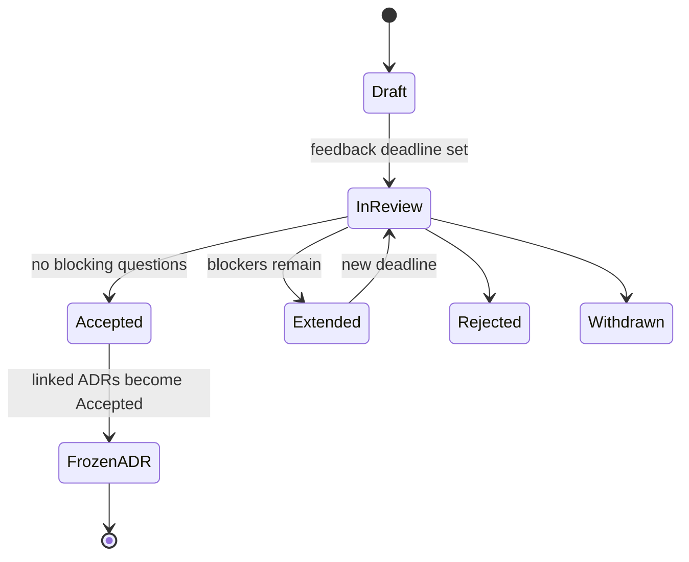

# RFC-0002: Engineering process baseline: RFC/ADR lifecycle, English-only artifacts, and mandatory mutation/regression tests

- **Status:** Draft
- **Author(s):** Gustavo
- **Reviewers:** Gustavo (self-review); [FILL: external reviewer, if any]
- **Date:** 2026-11-01
- **Feedback deadline:** 2026-11-15 (extended from 2026-11-08: acceptance criteria 6 and 8 need a pinned Gremlins run in CI and a supersession dry run, which depend on open questions 4 and 5)
- **Related ADRs:** [ADR-0005](../adr/0005-rfc-adr-lifecycle.md), [ADR-0006](../adr/0006-english-only-artifacts.md), [ADR-0007](../adr/0007-mandatory-mutation-and-regression-tests.md)
- **Supersedes / Related:** [RFC-0001](0001-configurable-sandbox-for-agents.md), [ADR-0001](../adr/0001-sandbox-opencode-com-bwrap.md), [ADR-0002](../adr/0002-per-sandbox-state-and-credentials.md), [ADR-0003](../adr/0003-pinned-skills-and-snapshot.md), [ADR-0004](../adr/0004-quality-gate-hooks.md)
- **Origin:** draft ADRs produced from the grill of 2026-11-01. This RFC is bootstrapped from draft ADRs because the new workflow does not exist yet; after acceptance, new initiatives start with an RFC and produce ADRs at closure.

## 1. Summary

The repository's RFCs and ADRs currently duplicate each other: both contain context, alternatives, risks, and open questions, and the ADR is used as a design document. The process has not prevented implementation drift. This RFC proposes a split of responsibilities: RFCs debate the problem, options, acceptance criteria, and open questions; ADRs record the decision and its consequences and are frozen at acceptance; every ADR links to exactly one RFC. It also proposes English-only artifacts and mandatory mutation and regression tests. The expected impact is shorter, auditable decisions, no silent edits, and tests that detect faults rather than only executing lines.

## 2. Context and problem

### 2.1 Duplication between RFCs and ADRs

- ADR-0001 is 216 lines and RFC-0001 is 429 lines. Both repeat context, alternatives, risks, and open questions (ADR-0001 §"Alternatives considered", §"Consequences", §"Open questions"; RFC-0001 §6, §7, §11).
- ADR-0001 is `Proposed (in RFC)` and links RFC-0001. ADR-0002..0004 are `Proposed` and had no RFC; the links were retrofitted on 2026-11-02 as part of the ADR-0006 migration.
- There are no templates, status transition rules, freeze rule, or supersession convention in `docs/adr/` or `docs/rfc/`.
- The RFC has a final decision (`RFC-0001` §5 "Proposal" and §8 "Migration and rollout plan"), so it is not a debate document; the ADR also contains the decision, so the two documents compete.

### 2.2 Drift that the current process did not catch

- ADR-0001 says the `opencode-sandbox` wrapper and the legacy fallback were removed, and that there is no implicit `--profile host` (ADR-0001 §"Decision" line 86; RFC-0001 §5.2 line 118). The wrapper still existed and added `--profile host` when `asb.toml` was absent (`opencode-sandbox:19-21`). **Fixed on 2026-11-03:** the wrapper was removed with a regression test (RFC-0001 §11).
- ADR-0001 and RFC-0001 describe `asb exec` as the mechanism that delivers environment values by fd/file (ADR-0001 §"Decision"; RFC-0001 §5.2 and §5.4). The CLI has no `exec` subcommand (`cmd/asb/main.go:37-52`). **Recorded on 2026-11-03:** implementation pending, tracked as ADR-0001 open question 6 (RFC-0001 §11).
- These are factual contradictions, not open design questions. They are evidence that a decision record without an explicit acceptance/freeze step does not stay aligned with the code.

### 2.3 Language

- `README.md`, `docs/asb.md`, ADR-0001..0004, and RFC-0001 were in Portuguese; the translation landed on 2026-11-02 under ADR-0006.
- CLI help and errors were in Portuguese (`cmd/asb/main.go:115`, `internal/config/config.go:49`, `internal/proxy/allow.go:23`), and tests asserted Portuguese substrings; both were translated on 2026-11-02.
- There is no localization requirement and no translated UI. The Go/OpenCode ecosystem and upstream documentation are in English.

### 2.4 Testing

- CI runs `go test ./...`, `go vet ./...`, and `scripts/matrix.sh` (`.github/workflows/ci.yml`).
- There are 28 Go tests. Mutation testing is absent. Regression tests are mentioned in RFC-0001 (env secrets, `/tmp/asb`, DNS) but are not a merge gate.
- A local Gremlins v0.6.0 baseline on 2026-11-01 measured 312 mutants total: 199 runnable (150 killed, 47 lived, 2 timed out) and 113 not covered; efficacy 76.14%, mutant coverage 63.55%; about 29 seconds with 4 workers.
- The sandbox and allowlist threat model makes weak tests expensive: a surviving mutant in proxy or allowlist code can look like a passing security test.

### 2.5 If nothing changes

The repository keeps two competing design documents, accepts decisions that the code contradicts, mixes Portuguese and English (until the dedicated translation landed on 2026-11-02), and has no automated evidence that the test suite detects faults. The cost grows with every new ADR.

## 3. Goals and non-goals

**Goals:**

- **G1.** RFCs contain the problem, options, acceptance criteria, risks, migration, and open questions; no final decision.
- **G2.** ADRs contain the decision and consequences; no repeated alternatives; one link to the RFC.
- **G3.** Acceptance freezes ADRs semantically; a changed decision is a new ADR with `Supersedes`.
- **G4.** One RFC per initiative; one ADR per decision; every ADR links to exactly one RFC; ~100-line guideline for ADRs.
- **G5.** English is the only language for new documentation, code, comments, identifiers, CLI, tests, commits, PRs, issues, and branches; existing artifacts are migrated before RFC-0001 acceptance.
- **G6.** Every bug fix and security fix includes a regression test that fails before the fix; the PR carries the red run and the SHA-256 of the test file.
- **G7.** Mutation testing is a gate: Gremlins v0.6.0 on changed code per PR and a full run weekly; initial 70% efficacy and 60% mutant coverage, with an 80% mutant-coverage target.
- **G8.** Templates, a PR checklist, and a lightweight CI metadata/link check make the process enforceable without a custom state-machine linter.

**Non-goals:**

- Rewriting the content of ADR-0001..0004 or RFC-0001 in this initiative.
- A full ADR state-machine linter or automatic freeze detection in v1.
- Localization or translated CLI output.
- A code-coverage threshold; mutation testing is the quality signal.
- Changing the sandbox, proxy, or allowlist design.
- Rewriting git history to translate old commits.

## 4. Requirements and constraints

| Requirement | Type | Origin |
|---|---|---|
| RFC has no final decision | Must | User request; grill |
| ADR has decision + consequences, no alternatives; one link to the RFC | Must | User request |
| Every ADR links to exactly one RFC | Must | Grill (user chose "every ADR requires an RFC") |
| One RFC per initiative; one ADR per decision | Must | User request |
| ADR size guideline: ~100 lines or ~800 words, excluding metadata | Should | Grill |
| RFC acceptance requires no blocking open questions; otherwise extend or reject | Must | Grill |
| Accepted ADR is semantically frozen; non-semantic edits need a Revisions row and decider approval | Must | Grill |
| Changed decision becomes a new ADR with `Supersedes` | Must | User request |
| English for all new artifacts; migrate existing before RFC-0001 acceptance | Must | User request; grill |
| Regression test with red run + SHA-256 of the test file | Must | Grill |
| Gremlins v0.6.0 pinned; diff per PR + weekly full | Must | Tool verification; grill |
| Initial mutation gate: 70% efficacy / 60% mutant coverage; 80% mcover target | Must | Local baseline; grill |
| Single maintainer; no external reviewer guaranteed | Constraint | Repository |
| CI runs on Ubuntu; WSL has no automated runner | Constraint | `.github/workflows/ci.yml`; RFC-0001 |
| Templates + PR checklist + lightweight CI metadata/link check | Must | Grill |

## 5. Options

### 5.1 Lifecycle

**Option A — Separated lifecycle (RFC debates, ADR decides, freeze + supersession).**
The RFC holds problem, options, criteria, risks, migration, and open questions. ADRs are drafted as `Proposed`, become `Accepted` at RFC acceptance, and freeze. Changes produce a new ADR with `Supersedes`.

- **Pros:** one job per document; the decision is short and auditable; the debate stays editable; freeze prevents silent drift; supersession preserves history.
- **Cons:** two artifacts per initiative; status bookkeeping; discipline to keep the RFC decision-free; retrofit work.

**Option B — Single RFC with decision + ADR index.**
The RFC contains the full debate and the decision; a short ADR only links to it.

- **Pros:** one place for rationale; fewer files; less ceremony.
- **Cons:** the RFC becomes a decision document; the ADR has no stable content to freeze; the decision changes when the RFC is edited.

**Option C — Current combined model.**
Both RFC and ADR contain context, alternatives, risks, and decision.

- **Pros:** no migration; readers can start from either document.
- **Cons:** duplication; competing decisions; drift; no freeze; the observed 216/429-line documents.

**Option D — No formal process.**
Decisions live in PRs and issues.

- **Pros:** zero ceremony; fastest for small changes.
- **Cons:** no durable decision record; rationale lost; no audit trail; drift continues.

| Criterion | A | B | C | D |
|---|---|---|---|---|
| Single responsibility | Good | Poor | Poor | None |
| Auditability | Good | Medium | Medium | Poor |
| Reviewability | Good | Medium | Poor | Medium |
| Drift prevention | Good | Poor | Poor | None |
| Ceremony cost | Medium | Low | High | None |
| Migration cost | Medium | Medium | None | None |

**Preferred (non-binding): Option A.** The drift evidence in §2.2 is the deciding factor: a stable, short decision record with an explicit acceptance point is the only option that makes "frozen" meaningful.

### 5.2 Language

**Option A — English-only for new artifacts, migrate existing artifacts in a dedicated PR.**
New docs/code/CLI/tests/commits/PRs/issues/branches are English. A dedicated PR translates existing docs, CLI strings, and test assertions, renames files, and updates links before RFC-0001 acceptance.

- **Pros:** one vocabulary; easier onboarding and upstream comparison; searchable CLI errors; no mixed-language new content.
- **Cons:** translation cost (~1,200 lines of docs plus CLI/tests); meaning-drift risk; link churn; mixed language until the migration PR.

**Option B — English for new content only, grandfather Portuguese.**
- **Pros:** no translation cost; no link churn.
- **Cons:** permanent mixed language; two vocabularies; contradicts "all documentation, code, CLI in English".

**Option C — Bilingual documentation.**
- **Pros:** accessible to Portuguese readers.
- **Cons:** double maintenance; divergence; no localization requirement.

**Option D — Translate everything in the same PR as the process change.**
- **Pros:** one big cut; no intermediate state.
- **Cons:** unreviewable diff; mixes process and translation; high risk of semantic drift.

**Preferred (non-binding): Option A.** It keeps the process change reviewable and still reaches English-only before any ADR is frozen.

### 5.3 Testing

**Option A — Gremlins v0.6.0 diff per PR + weekly full; regression test with red run + hash.**
- **Pros:** fast PR feedback (local full run ~29 s; diff is smaller); full baseline weekly; regression evidence is bound to the test content.
- **Cons:** Gremlins is 0.x; diff has known edge cases with subdirectories; CI runtime unknown; survivors need triage.

**Option B — Full Gremlins run on every PR.**
- **Pros:** strongest per-PR signal.
- **Cons:** slower and costlier; unnecessary for docs-only or small changes.

**Option C — Mutation testing only at release.**
- **Pros:** low day-to-day friction.
- **Cons:** test-quality regressions accumulate until release; not a merge gate.

**Option D — Regression tests only, no mutation testing.**
- **Pros:** simple; no new tool.
- **Cons:** does not measure whether tests detect faults; the original problem remains.

| Criterion | A | B | C | D |
|---|---|---|---|---|
| Fault detection | Good | Good | Medium | Low |
| PR feedback | Good | Poor | Good | Good |
| CI cost | Medium | High | Low | Low |
| Regression evidence | Good | Good | Medium | Medium |
| Tool maturity | Medium (0.x) | Medium | Medium | High |

**Preferred (non-binding): Option A.** The local baseline shows a full run is feasible; diff per PR keeps the gate useful without making every PR pay the full cost.

## 6. Recommendation (non-binding)

The author prefers Option A in all three areas:

1. **Lifecycle A:** separated RFC/ADR roles, semantic freeze, supersession.
2. **Language A:** English-only for new artifacts, dedicated migration before RFC-0001 acceptance.
3. **Testing A:** Gremlins v0.6.0 diff per PR + weekly full, 70% efficacy / 60% mutant coverage initial, 80% mutant-coverage target, regression red run + SHA-256.

This recommendation does not freeze or replace anything in the ADRs. ADR-0005, ADR-0006, and ADR-0007 record the proposed decisions and become `Accepted` only if this RFC is accepted.

## 7. Risks and mitigations

| Risk | Probability | Impact | Mitigation | Reversal trigger |
|---|---|---|---|---|
| RFC becomes a decision document again | Medium | High | Template forbids a decision section; PR checklist | A merged RFC contains a final decision → fix the template/check |
| ADR loses the rationale | Medium | Medium | ADR links to the RFC; RFC keeps options and evidence | Reviewers cannot reconstruct why → add context to the RFC |
| Freeze blocks legitimate corrections | Medium | Low | Semantic freeze: non-semantic edits with Revisions row and decider approval | A needed correction is blocked → clarify the freeze rule |
| Ceremony for small changes | High | Medium | Group related ADRs under one initiative RFC; ~100-line guideline | More than 3 RFCs in a month for small changes → revisit "every ADR requires RFC" |
| Translation changes meaning | Medium | High | Dedicated PR; structure-preserving; review against the original | A translated decision differs → revert and re-review |
| Broken links after renaming | Medium | Low | CI link check | Broken link in CI → fix before merge |
| Mixed-language repository during migration | High | Low | "No new Portuguese" rule; migration checklist | New Portuguese content merges → fix in the same PR |
| Gremlins diff is slow or unreliable in CI | Medium | Medium | Measure the first CI run; fall back to weekly full if needed | Diff job exceeds the agreed budget → switch to weekly only |
| Gremlins 0.x flag changes | Medium | Low | Pin v0.6.0; review upgrades explicitly | Upgrade breaks the gate → pin the previous version |
| Red-run evidence is ignored | Medium | High | PR template requires the link and SHA-256; reviewer checklist | A fix merges without red evidence → block and re-review |
| Every ADR requires an RFC creates a backlog | Medium | Medium | Group ADRs under an initiative RFC; revisit after 3 initiatives | RFC backlog delays a critical fix → revisit the rule |

## 8. Migration and rollout

1. **Phase 0 — feedback (until 2026-11-15).** Review this RFC; resolve or record blocking questions. Do not accept while a blocking question remains.
2. **Phase 1 — process scaffolding.** Create `docs/rfc/TEMPLATE.md` and `docs/adr/TEMPLATE.md`; add the PR checklist and the lightweight CI metadata/link check. Retrofit ADR-0002..0004 with a link to RFC-0001 and English status metadata; do not rewrite their content. Update RFC-0001's deadline (proposed 2026-11-08) and record the drift.
3. **Phase 2 — English migration.** Translate docs, CLI strings, and test assertions; rename files to English slugs; update all links. This PR merges before RFC-0001 acceptance.
4. **Phase 3 — testing gate.** Add Gremlins v0.6.0 to CI: diff per PR and weekly full; thresholds 70/60; record the baseline; add a seeded-bug check and a regression-test demo with red run + SHA-256.
5. **Phase 4 — acceptance (2026-11-15).** Accept RFC-0002 and RFC-0001; move linked ADRs to `Accepted`; freeze them; run a supersession dry run.

**Compatibility:** existing ADRs remain readable during the transition. Their content is not rewritten; only metadata and links change. RFC-0001 is not accepted until the wrapper/`asb exec` drift is fixed or explicitly recorded.

**Rollback:** remove the templates/CI checks and keep the ADRs as `Proposed`; no data migration. File renames are reversible in git. If Gremlins is too slow, keep the weekly full run and drop the per-PR diff until the runtime is acceptable.

**Irreversible:** accepting and freezing an ADR is a semantic commitment; reversing it requires a new ADR with `Supersedes`. File renames do not lose history because git tracks them.

## 9. Impact

- **Operation:** new templates, PR checklist, CI metadata/link check, Gremlins job, and a translation PR.
- **Cost:** translation of roughly 1,200 lines of docs plus CLI strings and tests; Gremlins full run measured at ~29 s locally, CI cost to be measured; ongoing survivor triage.
- **Security:** stronger evidence that proxy/allowlist tests detect faults; no runtime change.
- **Performance:** CI time increases; no runtime impact on `asb`.
- **Other teams:** none known; the repository has a single maintainer and no external consumers of the docs.
- **Documentation/training:** templates, a short process guide, and English CLI output.

## 10. Acceptance criteria

This RFC is accepted when all of the following are true:

- [ ] RFC-0002 and ADR-0005/6/7 follow the new format: the RFC has no final decision; the ADRs have no alternatives section and link to the RFC.
- [ ] `docs/rfc/TEMPLATE.md` and `docs/adr/TEMPLATE.md` exist and encode the two roles.
- [ ] The PR checklist and the CI metadata/link check exist and fail on a missing status, RFC link, or `Supersedes`.
- [ ] ADR-0002..0004 link to RFC-0001; RFC-0001's deadline is updated; no content rewrite.
- [ ] The translation PR is merged; new artifacts are English; CLI help/errors and tests are English; renamed files have no broken links.
- [ ] Gremlins v0.6.0 runs on PR diff and weekly full; the 70/60 gate is green on the baseline; the baseline is recorded; a seeded bug is killed.
- [ ] The regression-test template requires the red run and the SHA-256 of the test file; a demo PR shows both.
- [ ] No accepted ADR is semantically edited; a supersession dry run passes.
- [ ] Every open question in §11 is resolved or explicitly marked non-blocking.
- [ ] RFC-0001 is accepted only after the wrapper/`asb exec` drift is fixed or recorded.

## 11. Open questions

**Resolved on 2026-11-03:**

| # | Question | Resolution | Evidence |
|---|---|---|---|
| 1 | New deadline and acceptance date for RFC-0001 after the drift is fixed or recorded | Deadline extended to 2026-11-08; wrapper drift fixed, `asb exec` drift recorded (RFC-0001 §11) | RFC-0001 status `In review`; `internal/run/legacy_wrapper_test.go` red/green |
| 3 | Translation PR sequencing and reviewer | Translation landed on 2026-11-02, before any acceptance; reviewer Gustavo (self-review, single maintainer) | Commit `a1731ba` |

**Resolved on 2026-11-06:**

| # | Question | Resolution | Evidence |
|---|---|---|---|
| 4 | Gremlins `--diff` base in CI and fork behavior | Use the pull-request base SHA from the event (`github.event.pull_request.base.sha`; `github.event.before` on push) and skip the job when the diff is empty; the weekly full run covers `main` | 2026-11-06 decision; `gremlins unleash --help` (`-D, --diff string: diff branch or commit`) |
| 5 | Where to record equivalent mutants | `docs/mutation-triage.md`, a single table linked from `docs/README.md`; ADR-0007 references it | 2026-11-06 decision; one canonical home per ADR-0008 |

**Still open:**

| # | Question | Owner | Blocks approval? | Due |
|---|---|---|---|---|
| 2 | Exact CI metadata/link check: script vs. action; required fields | Gustavo | No | 2026-11-08 |
| 6 | CI runtime of Gremlins; threshold for falling back to weekly only | Gustavo | No | After the first CI run |
| 7 | Whether accepted ADRs need CODEOWNERS or a CI guard against edits | Gustavo | No | 2026-11-15 |
| 8 | Whether "every ADR requires an RFC" creates too many RFCs | Gustavo | No | Revisit after 3 initiatives |
| 9 | Whether commit/PR/issue titles are enforced by CI or review only | Gustavo | No | 2026-11-15 |

## 12. Questions for reviewers

1. Is the separation worth two artifacts, or is the single-RFC-with-ADR-index model better for a one-maintainer repository?
2. Is "every ADR requires an RFC" too strict? Should small decisions join an existing initiative RFC?
3. Is semantic freeze enough to prevent drift, or do we need a CI check that detects edits to accepted ADRs?
4. Is the English migration worth the churn now, or should it wait until the sandbox v1 is accepted?
5. Are 70% efficacy / 60% mutant coverage meaningful thresholds, or should we target 80% mutant coverage immediately?
6. Is the red-run + SHA-256 evidence practical for security fixes that cannot be shown publicly?
7. Does Gremlins `--diff` handle this repository's package layout reliably? Known issue: diff mode can skip mutations when invoked with a subdirectory argument; the proposal runs from the module root.
8. Should RFC-0001 be retrofitted into the new format or superseded by a new RFC?

## 13. References

- [ADR-0005](../adr/0005-rfc-adr-lifecycle.md), [ADR-0006](../adr/0006-english-only-artifacts.md), [ADR-0007](../adr/0007-mandatory-mutation-and-regression-tests.md)
- [ADR-0001](../adr/0001-sandbox-opencode-com-bwrap.md), [ADR-0002](../adr/0002-per-sandbox-state-and-credentials.md), [ADR-0003](../adr/0003-pinned-skills-and-snapshot.md), [ADR-0004](../adr/0004-quality-gate-hooks.md)
- [RFC-0001](0001-configurable-sandbox-for-agents.md)
- `.github/workflows/ci.yml` — current CI (unit tests, vet, matrix)
- `opencode-sandbox:19-21` — wrapper fallback to `--profile host`
- `cmd/asb/main.go:37-52` — subcommands; no `exec`
- `cmd/asb/main.go:115`, `internal/config/config.go:49`, `internal/proxy/allow.go:23` — Portuguese CLI/errors before the ADR-0006 migration
- [Gremlins v0.6.0 release](https://github.com/go-gremlins/gremlins/releases/tag/v0.6.0) and [documentation](https://gremlins.dev)
- [Gremlins issue #278](https://github.com/go-gremlins/gremlins/issues/278) — `--diff` mode can skip mutations when invoked with a subdirectory argument; the proposal runs from the module root.
- Local baseline, 2026-11-01: `gremlins unleash --workers 4 --timeout-coefficient 3 --output /tmp/opencode/gremlins-baseline.json`; 312 mutants total: 199 runnable (150 killed, 47 lived, 2 timed out) and 113 not covered; efficacy 76.14%, mutant coverage 63.55%; ~29 s.
- Local run, 2026-11-06: `go install github.com/go-gremlins/gremlins/cmd/gremlins@v0.6.0`, then `gremlins unleash --workers 4 --timeout-coefficient 3 --threshold-efficacy 70 --threshold-mcover 60 --output /tmp/opencode/gremlins-v0.6.0-2026-11-06.json`; 185 killed, 45 lived, 80 not covered, 2 timed out; efficacy 80.43%, mutant coverage 74.19%; 27 s; exit 0, so the 70/60 thresholds pass. The binary prints `gremlins version dev` because the version is injected at build time; the pin is the module version in the install command. The 45 `LIVED` mutants are listed in [`docs/mutation-triage.md`](../mutation-triage.md).
- Seeded-bug check, 2026-11-06: changing `r < 'a'` to `r <= 'a'` in `ValidateSandboxID` made `go test ./internal/config` fail in `TestValidateSandboxID` and `TestConfigValidation`; reverting restored green. Removing `TestValidateSandboxID` then moved four mutants at `internal/config/config.go:501` from `KILLED` to `LIVED`, so that test is what kills them; efficacy fell from 80.43% to 78.70%.
- Supersession dry run, 2026-11-06: in a throwaway worktree (not committed), a proposed ADR-0010 declared `Supersedes: ADR-0008` and ADR-0008 gained `Superseded by: ADR-0010` plus a Revisions row; `scripts/check-docs.sh` passed (13 metadata files, 104 links) and both directions resolved.
- User request and grill answers, 2026-11-01 (conversation record).

## Revisions

| Date | Change | Reason |
|---|---|---|
| 2026-11-01 | Initial RFC generated from the grilled ADR-0005/6/7 | Process change request; bootstrapped because the new workflow did not exist |
| 2026-11-03 | Open questions 1 and 3 resolved (RFC-0001 deadline extended to 2026-11-08 with drift fixed/recorded; translation landed in `a1731ba`) | Deadline closure work for RFC-0001 per ADR-0005 |
| 2026-11-06 | Feedback deadline extended to 2026-11-15 | Acceptance criteria 6 and 8 cannot be met by 2026-11-08; pinning Gremlins v0.6.0 in CI and the supersession dry run require open questions 4 and 5 to be resolved first |
| 2026-11-06 | Open questions 4 and 5 resolved: PR event SHA as the diff base; `docs/mutation-triage.md` as the triage log | Decider answers; acceptance moved to 2026-11-15 together with RFC-0001 |
| 2026-11-06 | Gremlins v0.6.0 diff and weekly jobs wired through `scripts/mutation.sh`; triage log created with the 45-mutant backlog; seeded-bug and supersession checks run | Acceptance criteria 6 and 8 evidence; ADR-0007 implemented ahead of acceptance and recorded as unvalidated premises |
| 2026-11-06 | Reviewers metadata: leftover Portuguese placeholder replaced with an English `[FILL: ...]` marker | English-only rule (ADR-0006); non-semantic edit |
